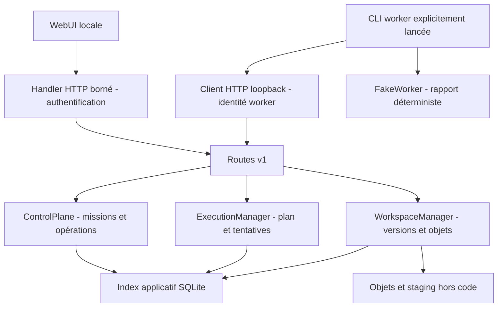

# B5.1 — journal d'implémentation

Base : `a4cb1411cbd10c1f03c2c00dc031ba8925bf9322` sur `main`, incluant les
merges PR #1, #2 et #3. Branche locale `feat/webui-control-plane-b51`, déjà
présente à cette base et sélectionnée sans modification préexistante à déplacer.
Aucun push, merge ou déploiement autorisé/réalisé dans ce chantier.

## B5.1a — fondations

IMPLÉMENTÉ : package `control_plane`, contrats versionnés Mission, Task, Attempt,
ExecutionResult, WorkspaceReference et AuditEvent ; services métier séparés des
routes ; index SQLite propre à l'application ; migration versionnée avec empreinte ;
permissions propriétaire/projet et identités admin/worker distinctes ; création de
brouillons, lecture et audit ; identifiants d'opération UUID idempotents.

Choix : bibliothèque standard Python, sans paquet tiers ni CDN, afin de conserver
une démo reproductible sans installation pip. CPython 3.11–3.13/POSIX visés,
Debian 13 visé ; la version réellement testée sera consignée en validation finale.
`control_plane/requirements.txt` déclare cette absence de dépendances tierces.
Le module SQLite fourni par Python est utilisé avec transactions explicites,
`foreign_keys=ON`, `synchronous=FULL` et un seul backend par répertoire verrouillé.
Les données POC PostgreSQL/SurrealDB et le Discovery Cache sont entièrement séparés.

Licences et références officielles consultées le 27 octobre 2026 :
[Python PSF-2.0 et notices incorporées](https://docs.python.org/3.13/license.html),
[SQLite domaine public](https://www.sqlite.org/copyright.html),
[sqlite3 et transactions](https://docs.python.org/3.13/library/sqlite3.html).
Ces composants n'imposent pas de changement de la licence Apache-2.0 du code
Pepeuch ; aucune distribution de runtime tiers n'est réalisée ici.

HTTP : adaptateur `http.server` borné, limité au loopback. La
[documentation officielle](https://docs.python.org/3.13/library/http.server.html)
ne recommande pas ce module en production : B5.1 reste un prototype local,
pas un serveur LAN prêt à exposer. Host/Origin vérifiés, pas de CORS ni cookies,
authentification Bearer obligatoire pour toutes les routes API, deux secrets
aléatoires locaux privés, aucune valeur codée en dur. Une interface publique
statique pourra charger le formulaire d'authentification, sans données privées.

TESTÉ à ce checkpoint : 15 tests B5.1, 272 tests historiques initiaux inchangés.
Les lots suivants ajouteront l'exécution simulée, les objets persistants et l'UI.

## B5.1b — exécution séparée

IMPLÉMENTÉ : `ExecutionManager` pour les tâches, tentatives et baux ; interface
`Coordinator` et plan consultable ; interface `Executor` et worker déterministe.
SIMULÉ : rôle `demo-report`, capacité déclarée `demo.report.v1`, worker `fake-cpu`.
Aucun modèle, matériel GPU ou benchmark n'est associé à cette déclaration.

L'approbation explicite journalise `draft → approved → queued` en une transaction.
Réclamer une tâche crée une tentative/génération nouvelles et passe à `running`.
Le worker n'exécute que la transformation texte prévue, sans outil ou interpréteur.
`failed`/`interrupted` ne sont repris qu'après une demande explicite. L'annulation
active devient `cancel_requested`, puis `cancelled` après accusé du worker ; une
expiration ou un redémarrage clôture la tentative comme `interrupted` et refuse
ses résultats tardifs. Un redémarrage ne réexécute aucune tâche de lui-même.

TESTÉ : 30 tests B5.1 cumulés, dont transitions, double approbation/réclamation,
capacité d'une seule tâche active, échec/interruption/annulation, expiration,
générations, absence de réseau/shell/attente et refus de terminer sans publication.
La publication durable réussie sera raccordée et testée dans B5.1c.

## B5.1c — objets et workspaces persistants

IMPLÉMENTÉ : upload borné, références logiques fichier/version, SHA256 vérifié,
versions immuables, téléchargement en pièce jointe, audit et quotas cumulés sur
toutes les versions. Noms ASCII plats, comparés sans distinction de casse ; refus
des chemins, noms réservés et caractères de contrôle. Limites par défaut : 1 Mio
par fichier, 16 Mio par workspace, 100 fichiers et 100 versions par fichier.
Les fichiers autorisés d'une mission désignent des versions figées, pas un chemin.

La publication crée un temporaire privé, vérifie les octets du staging, fsync le
fichier, renomme l'objet par son empreinte et fsync le répertoire ; l'index, le
résultat, l'audit et `completed` sont ensuite commités ensemble dans SQLite.
Une erreur avant commit laisse les anciennes versions intactes. Un crash peut
laisser un objet non référencé : il n'est pas visible comme livrable et n'est pas
supprimé automatiquement. Les résidus staging d'un autre processus sont ignorés.
La répétition exacte d'une réponse acceptée est acquittée sans nouvelle version.

TESTÉ : 51 tests B5.1 cumulés, avec succès complet puis redémarrage, download et
SHA identiques, conflit de version, deux uploads réellement concurrents, quota,
fichier trop grand, staging tronqué, corruption, symlink et interruptions avant
renommage ou après fsync avant commit. Pas de simulation de coupure électrique.
La rétention n'est pas une sauvegarde ; la procédure hors ligne sera documentée
avec les commandes de démonstration dans le dernier lot.

## B5.1d — interface et intégration

IMPLÉMENTÉ : trois sections utiles (tableau de bord, missions, espace de travail),
formulaire de brouillon, approbation avec confirmation explicite, plan, versions
autorisées, états/historique, demandes d'annulation et nouvelle tentative manuelle,
upload, choix des versions et téléchargements authentifiés. Ressources CSS/JS
locales et fontes système ; aucun paquet frontend, CDN ou conversation IA.
Le futur double panneau peut employer les mêmes API sans modifier les services.

TESTÉ : **69 tests B5.1**, plus **272 tests historiques** sans modification, et
un scénario navigateur Firefox **158.0.1** / geckodriver **0.37.1** en rendu logiciel.
Le navigateur contrôle login, brouillon, confirmation, texte HTML inerte, worker
dans un autre processus, téléchargement réel, deux versions uploadées, reprise du
backend et nouveau worker/client, largeur mobile et verrouillage. L'empreinte du
rapport avant/après redémarrage est identique. Les données/profils de ce scénario
sont temporaires ; seules des captures sans clé restent dans un dossier temporaire
indiqué par le script. Aucun navigateur ou driver n'a été installé.

Runtime effectivement testé ici : **CPython 3.12.3 / SQLite 3.45.1, Linux**.
Debian 13 / Python 3.13 sont des cibles compatibles avec les API utilisées mais
**n'ont pas été exécutés dans cet environnement**. Ni Docker ni Node ne sont des
dépendances de lancement ; Node a seulement servi à vérifier la syntaxe JavaScript.

Incidents et revue :

- Les premiers tests HTTP ont échoué sur le refus de sockets du bac à sable,
  avant toute requête. Rejoués avec l'autorisation de sockets exclusivement
  loopback : succès, sans saut ni désactivation de tests.
- Le premier parcours Firefox a détecté « Verrouiller » inaccessible sur mobile.
  Le bouton est maintenant dans l'en-tête visible à toutes les largeurs ; le
  scénario complet a ensuite réussi.
- La revue a ajouté une vérification de deadline **après** la publication des
  objets et avant le commit métier. Le test fait expirer la tentative pendant
  l'écriture : aucun `completed`, aucune version publiée dans l'index.

## Architecture réellement exécutée



`contracts.py` expose les contrats `Coordinator`/`Executor` et les DTO versionnés.
Le coordinateur simulé produit un plan ; seul le gestionnaire de tâches attribue
une tentative. Le worker appelle l'API, sans ouvrir l'index SQLite métier. Le
protocole actuel autorise une seule tâche active pour le worker de démonstration.
Les contraintes de capacité/rapport sont volontairement propres à cette démo ;
de futurs gestionnaires/protocoles les étendront sans détourner missions ou fichiers.

## Schémas et transitions

Chaque DTO porte `schema: pepeuch.control-plane/<type>/v1`.

| Type | Champs structurants |
| --- | --- |
| Mission | ID opaque, owner/project, workspace, titre/objectif, état, date, versions de fichiers autorisées, provenance ; projection avec plan/tâches/tentatives/résultats |
| Task | ID, mission, rôle, capacité déclarée, worker sélectionné, état, `simulated=true` |
| Attempt | ID distinct, tâche, numéro, worker, état, début UTC, deadline, code d'erreur public |
| ExecutionResult | Tentative, génération, état final, sorties bornées, code d'erreur fermé ; rejet des versions/champs inconnus |
| WorkspaceReference | ID logique et projet ; aucun chemin hôte |
| AuditEvent | ID/séquence, mission/workspace, acteur, date, type et détails fermés, sans objectif ou contenu utilisateur |

Le protocole ajoute `plan/v1`, `execution-request/v1`, `attempt-state/v1` et
`workspace-files/v1`. La requête d'exécution fixe la version de base de
`resultat.md`, la génération et la deadline. Le rapport reprend titre, mission,
tâche, objectif, date assignée et tentative ; ses octets sont déterministes pour
une même requête. Une capacité vérifiée ici signifie seulement **simulation
déterministe vérifiée**, jamais inférence, GPU ou compatibilité d'un modèle.

| État initial | Transitions autorisées |
| --- | --- |
| draft | approved, cancelled |
| approved | queued, cancelled |
| queued | running, cancelled |
| running | completed, failed, cancel_requested, interrupted |
| cancel_requested | cancelled, interrupted |
| failed | queued, sur retry explicite |
| interrupted | queued sur retry explicite, cancelled |
| completed / cancelled | aucune |

`approved` puis `queued` sont journalisés dans la même transaction. L'expiration
est matérialisée à la prochaine consultation/réclamation/réponse ; il n'existe
pas de scheduler de fond. Au démarrage du backend, toute tentative en cours est
clôturée/fencée comme interrompue, même si un ancien worker existe encore. Une
nouvelle tentative exige une action humaine ; une réponse ancienne ne peut plus
publier. Une réponse déjà acceptée à l'identique est acquittée sans nouvel effet.

Toutes les mutations administrateur et la réclamation worker exigent un
`operation_id` UUID. La même clé et le même contenu rejouent la réponse stockée ;
une clé réutilisée avec un contenu différent est refusée. Cette réponse reflète
l'opération initiale : consulter la mission pour son état courant. La fin worker
est dédupliquée par tentative/génération et SHA256 de la réponse complète.

## API locale v1

Toutes les routes `/api/v1/` exigent un Bearer valide. Aucun secret dans une URL.
Le corps POST est du JSON strict avec taille/framing bornés, sans clés répétées
ou nombres non finis. Les réponses d'erreur contiennent un code public constant.

| Méthode et route | Identité | Fonction |
| --- | --- | --- |
| GET `/api/v1/health` | admin | Santé minimale |
| GET `/api/v1/dashboard` | admin | Compteurs et activité |
| GET/POST `/api/v1/missions` | admin | 200 dernières missions / création du brouillon |
| GET `/api/v1/missions/{id}` | admin propriétaire | Détail, plan, tentatives et livrables |
| POST `/api/v1/missions/{id}/approve` | admin propriétaire | Approbation explicite |
| POST `/api/v1/missions/{id}/cancel` | admin propriétaire | Demande d'annulation |
| POST `/api/v1/missions/{id}/retry` | admin propriétaire | Nouvelle tentative explicitement autorisée |
| GET `/api/v1/missions/{id}/events` | admin propriétaire | Historique |
| GET `/api/v1/workspaces` | admin | Workspace initial autorisé |
| GET/POST `/api/v1/workspaces/{id}/files` | admin propriétaire | Listing / upload d'une version |
| GET `/api/v1/workspaces/{id}/files/{file_id}/download` | admin propriétaire | Dernière version |
| GET `/api/v1/workspaces/{id}/files/{file_id}/versions/{version_id}/download` | admin propriétaire | Version précise, pièce jointe et SHA256 |
| GET `/api/v1/nodes` | admin | Worker déclaré simulé ; présence en ligne non déduite |
| POST `/api/v1/execution/claim` | worker | Une tentative ou `request=null` |
| GET `/api/v1/execution/{attempt_id}/state` | worker de cette tentative | État et deadline, notamment annulation |
| POST `/api/v1/execution/{attempt_id}/finish` | worker de cette tentative | Résultat vérifié ou échec simulé |

Création : `operation_id`, `workspace_id`, `title` (160 caractères), `objective`
(4000 caractères), `authorized_files` optionnel (32 IDs de versions maximum).
Approve/cancel/retry/claim : `operation_id` uniquement. Upload : `operation_id`,
`name`, `size`, `sha256`, `content_base64`, `expected_version` (null pour création).
La taille JSON HTTP est limitée à 1 500 000 octets ; une sortie worker à 64 Kio
au plus et une seule sortie `resultat.md` dans ce contrat de démonstration.

## Données, configuration et secrets

Le répertoire doit être absolu, privé (0700), dédié et **hors du code**. Une racine
non vide non reconnue est refusée, sans effacement. Un marqueur versionné permet
de reconnaître l'installation, sans réinitialiser une base étrangère.

```text
<data-dir>/
  app/index.sqlite3      # missions, tâches, versions, opérations, événements
  app/backend.lock      # un seul backend local
  objects/<sha256>      # octets immuables ; aucun nom utilisateur comme chemin
  staging/<opaque-id>   # préparation locale, jamais un livrable visible
  logs/                 # réservé aux journaux techniques ; aucun log de corps HTTP
  config/installation.json
  config/settings.json  # tailles/quota/deadline, sans secret
  secrets/admin.token   # 0600, aléatoire, jamais retourné par l'API
  secrets/worker.token  # 0600, identité distincte
```

SQLite conserve le journal d'événements transactionnel, distinct des logs techniques.
Les fichiers privés sont contrôlés (type, propriétaire, permissions, symlinks et
hardlinks). Les secrets sont créés une fois, lus au démarrage et conservés hors
Git. L'interface garde l'admin Bearer uniquement en mémoire, sans cookie,
localStorage/sessionStorage ni lien de téléchargement portant la clé. Le champ
de saisie est vidé, et le verrouillage efface les données affichées.

La migration `0001.sql` est appliquée dans une transaction et son empreinte est
vérifiée aux démarrages suivants. Une version/empreinte inconnue est refusée.
Aucune migration PostgreSQL/SurrealDB/Discovery Cache n'est introduite.

## Démarrage et démonstration reproductibles

Depuis la racine du dépôt, avec Python disposant du module standard SQLite :

```bash
export PEPEUCH_B51_DEMO_DIR="$(mktemp -d /tmp/pepeuch-b51-demo.XXXXXX)"
python3 -m control_plane init --data-dir "$PEPEUCH_B51_DEMO_DIR"
printf 'Répertoire de cette démo : %s\n' "$PEPEUCH_B51_DEMO_DIR"
python3 -m control_plane serve --data-dir "$PEPEUCH_B51_DEMO_DIR" --port 8765
```

1. Ouvrir `http://127.0.0.1:8765`. Dans un éditeur local, ouvrir le fichier
   `<data-dir>/secrets/admin.token` et copier sa valeur dans le formulaire. Ne pas
   envoyer la clé dans un chat ni la placer dans un historique de commandes.
2. Créer une mission, lire son brouillon puis confirmer « Confier au coordinateur
   simulé ». Elle devient « En attente », avec plan et attribution consultables.
3. Dans un second terminal, définir `PEPEUCH_B51_DEMO_DIR` avec **le même chemin**
   affiché plus haut, puis lancer :

```bash
python3 -m control_plane worker --data-dir "$PEPEUCH_B51_DEMO_DIR" --once --interactive
```

4. Le terminal attend Entrée après attribution : observer `running` dans l'UI.
   Appuyer sur Entrée pour produire `resultat.md`. L'UI affiche la simulation
   terminée et le bouton de téléchargement. Le rapport n'est pas une réponse IA.
5. Téléverser un petit fichier puis une seconde version de même nom ; consulter
   et télécharger les deux versions. Un conflit concurrent est refusé.
6. Arrêter backend et worker (Ctrl-C), relancer le backend avec le même chemin,
   se reconnecter puis retélécharger le résultat. Vérifier son SHA256 localement.

Sans `--interactive`, le worker traite au plus une tâche puis quitte. `--loop`
active explicitement une boucle locale ; elle n'est jamais démarrée par le backend.
`--mode fail`, `--mode interrupt` et `--mode hold` démontrent respectivement échec,
interruption et tentative laissée en cours jusqu'à expiration/redémarrage.
En mode interactif, demander l'annulation dans l'UI avant Entrée permet au worker
de l'acquitter sans produire de fichier. Ctrl-C d'un worker laisse une tentative
à interrompre par expiration/redémarrage ; ce n'est pas un succès implicite.

Pour un chemin durable, choisir un répertoire privé sur un disque persistant et
le fournir à `--data-dir`. `/tmp` est destiné ici à la **démo jetable**, pas à une
sauvegarde ou au stockage pérenne. Aucun compose n'est requis ; aucun service
permanent, conteneur privilégié, port LAN ou installation VM n'est créé.

Depuis une autre machine, garder le backend sur loopback et employer un tunnel
SSH vers ce loopback, sans publier l'API en clair sur le LAN. Une ouverture LAN
TLS/authentifiée, appairage et gestion multi-utilisateurs restent NON IMPLÉMENTÉS.

## Validation et nettoyage ciblé

```bash
PYTHONDONTWRITEBYTECODE=1 python3 -m unittest discover -s tests/control_plane -p 'test_*.py' -v
python3 -m unittest discover -s database/poc -p 'test_*.py' -q
node --check control_plane/web/app.js  # vérification facultative si Node est installé
git diff --check
```

Les tests HTTP requièrent l'autorisation d'ouvrir des sockets **loopback**, pas
Internet. Tous leurs répertoires sont temporaires ; aucun n'écrit sous `/opt` ou
dans les données POC. Les tests de worker bloquent réseau externe/subprocessus/
attentes réelles ; les tests HTTP synchronisent de vrais échanges locaux. Les
horloges de tentative sont injectées, sans attendre une vraie expiration.

Test navigateur optionnel, uniquement avec des binaires déjà installés :

```bash
python3 tests/browser_b51.py \
  --firefox-binary /chemin/vers/firefox \
  --geckodriver-binary /chemin/vers/geckodriver
```

Ce test crée son propre profil et ses données ; il ne touche pas au profil Firefox
personnel. Les attentes bornées servent uniquement à synchroniser démarrage du
navigateur et téléchargement. Le rendu est logiciel et le trafic navigateur
externe est dirigé vers un proxy loopback fermé, hors loopback explicitement permis.

Pour nettoyer **uniquement la démo créée plus haut**, arrêter ses processus,
vérifier le chemin affiché et son contenu, puis utiliser une suppression interactive
limitée à ce préfixe temporaire. Ne pas appliquer à un chemin durable :

```bash
case "$PEPEUCH_B51_DEMO_DIR" in
  /tmp/pepeuch-b51-demo.*)
    if [ "$(dirname -- "$PEPEUCH_B51_DEMO_DIR")" = /tmp ] &&
       [ ! -L "$PEPEUCH_B51_DEMO_DIR" ] &&
       [ -f "$PEPEUCH_B51_DEMO_DIR/config/installation.json" ]; then
      ls -la -- "$PEPEUCH_B51_DEMO_DIR"
      rm -ri -- "$PEPEUCH_B51_DEMO_DIR"
    else
      printf 'Refus : répertoire non conforme.\n'
    fi ;;
  *) printf 'Refus : chemin hors de la démo temporaire.\n' ;;
esac
```

Cette procédure n'est jamais lancée automatiquement. Aucun nettoyage global,
aucune purge d'historique ou d'autres temporaires n'est prévu par l'application.

## Limites de sécurité et travaux B5.2

- Prototype **loopback à utilisateur local de confiance** : `http.server` n'est
  pas une pile de production. Host/Origin, Bearer, framing, délais socket, 16
  connexions actives et tailles bornées réduisent le périmètre ; ils ne remplacent
  pas un serveur HTTP durci, TLS et une revue avant exposition.
- Deux rôles API réels mais **même compte OS local** dans la démonstration : le
  faux worker n'est pas un sandbox contre un processus malveillant de ce compte.
  Un vrai worker exigera séparation OS, appairage, révocation, baux et permissions
  propres ; aucun outil arbitraire n'est autorisé par B5.1.
- Clés privées locales, pas de login multi-utilisateurs, rotation à chaud, coffre,
  chiffrement des données au repos ou protection contre le propriétaire malveillant
  du stockage. Système de fichiers local POSIX privé supposé ; pas de promesse NFS.
- Deadline sur horloge système de confiance et vérifiée à l'acceptation finale ;
  aucun mécanisme de préemption d'un code arbitraire, ni arrêt instantané d'un
  processus déconnecté. Le seul calcul exécuté est la transformation bornée de démo.
- Quota logique des versions, pas quota physique global de SQLite/staging/objets
  orphelins. Historique conservé, pas de suppression automatique, pagination complète,
  traitement d'archives, aperçu de contenu actif ou édition collaborative.
- Avant B5.2 : formaliser les schémas étendus et agents réels, durcir HTTP/identité,
  choisir l'isolation worker et éprouver les sauvegardes. Conversations, interfaces
  tierces, scheduler distribué, modèles, GPU, USB et Proxmox restent hors de B5.1.

### Sauvegarde/restauration à prévoir

La rétention ne protège pas d'une perte de disque. Stratégie initiale recommandée :
arrêter backend et worker, copier **ensemble** index applicatif, objets et
configuration dans une sauvegarde privée hors machine ; traiter les secrets
séparément avec chiffrement et contrôle d'accès. Restaurer dans un nouveau
répertoire privé, vérifier migration, intégrité SQLite, références et empreintes,
puis tester téléchargements avant reprise. Ne pas copier SQLite à chaud sans
une procédure cohérente dédiée. Une réinitialisation d'horloge/état nécessite une
réconciliation des tentatives et des identités.

Le redémarrage et les corruptions sont TESTÉS ici ; une sauvegarde/restauration
hors machine complète n'est **pas encore testée** et reste un lot B5.2.

## Inventaire des fichiers du lot

| Domaine | Fichiers créés |
| --- | --- |
| Package et lancement | `control_plane/__init__.py`, `control_plane/__main__.py`, `control_plane/requirements.txt` |
| Contrats et sécurité | `control_plane/contracts.py`, `control_plane/auth.py` |
| Métier et persistance | `control_plane/service.py`, `control_plane/storage.py`, `control_plane/migrations/0001.sql`, `control_plane/workspace.py` |
| Exécution simulée | `control_plane/execution.py`, `control_plane/demo.py`, `control_plane/worker_client.py` |
| HTTP et interface | `control_plane/http_api.py`, `control_plane/web/index.html`, `control_plane/web/styles.css`, `control_plane/web/app.js` |
| Tests | `tests/control_plane/test_foundations.py`, `test_api.py`, `test_execution.py`, `test_workspace.py`, `test_http_integration.py` dans le même répertoire ; `tests/browser_b51.py` |
| Documentation | `docs/architecture/B51_IMPLEMENTATION.md` |

`README.md` et `TODO.md` sont actualisés. Les quatre documents B5.0, les fichiers
d'infrastructure et l'intégralité de `database/poc` restent inchangés.
