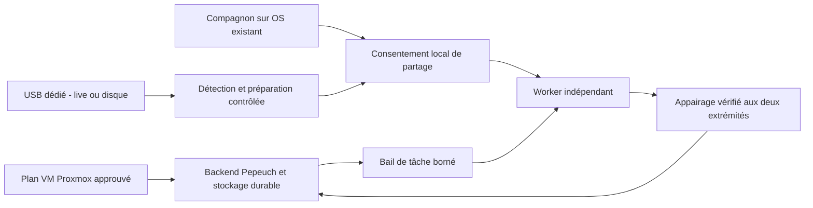
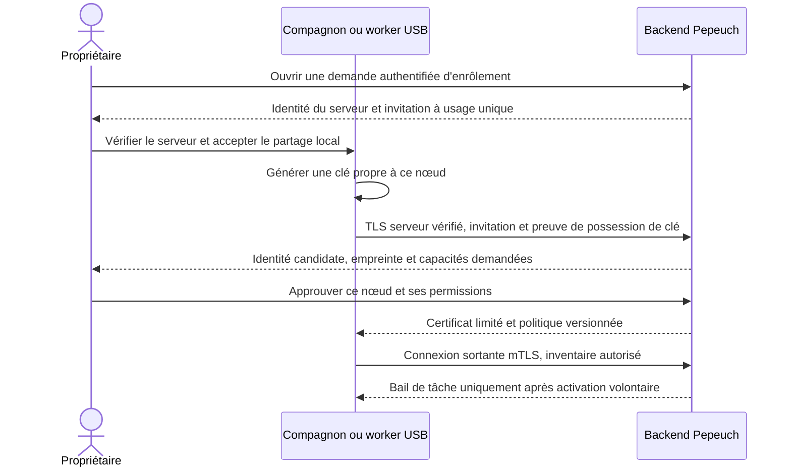

# B5.0 — trois parcours de déploiement et contrat commun de nœud

Proposition du 27 octobre 2026. Aucun provisionnement, script nouveau, image USB,
installation, accès hyperviseur ou test matériel n'est exécuté. Tous les flux
ci-dessous sont des contrats à réaliser puis à valider, pas du support opérationnel.

## Comparaison et séquence recommandée

| Critère | Serveur en VM Proxmox | Compagnon Windows/macOS/Linux | USB sur machine dédiée ou sans OS |
| --- | --- | --- | --- |
| Rôle principal | Backend, API, état durable et administration du cluster | Découverte, appairage et activation volontaire d'un worker sur l'OS existant | Amorçage/installation d'un worker dédié, éventuellement live |
| Public | Propriétaire d'un hôte Proxmox existant | Utilisateur conservant son ordinateur et ses applications | Propriétaire d'une machine réaffectée ou nue |
| Prérequis | Proxmox administré, stockage/bridge/VMID disponibles, image et version vérifiées | Application signée/packagée pour l'OS et architecture ; permissions demandées au besoin | Support USB, possibilité de boot, architecture/UEFI compatibles ; réseau ou paquets embarqués |
| Isolation | VM pour le serveur ; worker éventuel séparé | Limites du compte utilisateur et du runtime ; coexistence avec l'usage personnel | OS dédié plus prévisible ; live reste limité par son support |
| Opérations sensibles | Créer disque/VM, changer réseau, passthrough éventuel | Installer service/driver, ouvrir pare-feu, partager disque/GPU | Effacer USB puis éventuellement disque système ; confirmations séparées |
| Persistance | Volumes backend sauvegardés hors couche conteneur | Cache de calcul local ; livrables validés transférés au serveur | Disque dédié ou partition live chiffrée ; ne pas dépendre d'une clé seule pour les livrables |
| Partage des ressources | Réservation explicite de vCPU/RAM/disque ; GPU non requis pour le serveur | Opt-in CPU/RAM/GPU/disque/réseau ; arrêt/pause locale prioritaire | Budget dédié configurable ; garder une réserve pour l'OS |
| Échec/retrait | Reprise serveur depuis sauvegarde testée, pas simple rollback aveugle | Veille, batterie, déconnexion ou révocation : arrêt des nouveaux baux | Retrait USB, panne support, pilote/boot incompatibles : rester non disponible |
| Maintenance | Image/version/backend + sauvegardes et migrations ultérieures validées | Matrice multi-OS, signatures, mises à jour, coexistence | Images et chaîne d'amorçage, drivers, reprise/rollback et compatibilité matérielle |
| Priorité proposée | D'abord un plan d'installation révisable, après premier pilote backend | Pilote Linux CPU, puis Windows/macOS avec un worker commun | Ensuite, sur matériel dédié de test ; live après installation disque validée |

Le serveur en VM ne transforme pas automatiquement l'hyperviseur ou ses autres
VM en workers. Le compagnon n'installe pas Proxmox et ne remplace pas l'OS de
l'utilisateur. L'USB n'est pas nécessaire pour rejoindre depuis un OS existant.
Les trois chemins convergent vers les mêmes contrats d'identité, de consentement,
d'inventaire et de tâche. AnythingLLM reste facultatif ; voir
[l'étude moteur/UI versus worker](OPEN_WEBUI_ANYTHINGLLM_STUDY.md).

## VM Proxmox : automatisation envisagée

Le dépôt possède déjà [un bootstrap VM](../../infrastructure/proxmox/README.md)
et `create-ai-vm.sh` : Debian cloud-init, préparation Docker et compose placeholder,
sans passthrough automatique. Il a été lu, pas exécuté ni modifié. Il ne constitue
pas encore un installeur complet du futur serveur Pepeuch.

Proxmox documente les templates cloud-init et le paramétrage réseau/clés SSH :
[source officielle cloud-init](https://github.com/proxmox/pve-docs/blob/master/qm-cloud-init.adoc).
Les pages `pve.proxmox.com` ont renvoyé 403 lors de cette étude ; le texte du
dépôt officiel a été consulté en remplacement. Le
[guide PCI passthrough](https://github.com/proxmox/pve-docs/blob/master/qm-pci-passthrough.adoc)
explique les prérequis IOMMU et l'affectation exclusive du périphérique à la VM.
Un GPU détecté sur l'hôte n'est donc pas présumé disponible dans la VM.

Futur flux : inventorier sans mutation → afficher un plan (VMID libre, stockage,
bridge, vCPU/RAM/disque, version/image vérifiée, règles réseau) → approbation →
création suivie par étapes idempotentes → premier démarrage → configuration
backend sans secret durable dans les snippets → contrôle de santé et sauvegarde.
Ne jamais remplacer une VMID ou un disque existant au nom d'une reprise.
L'hôte garde ses identifiants Proxmox ; un agent de calcul ne les reçoit jamais.

La VM héberge les API et données sur volumes persistants, avec sauvegarde hors VM
et essai de restauration. Un snapshot hyperviseur n'est pas une garantie de
cohérence d'application ou une sauvegarde contre la perte de l'hôte. En cas de
restauration ancienne, invalider/renouveler les baux et contrôler les certificats :
le retour d'horloge ou d'état ne doit pas autoriser le rejeu d'une tâche.
Le serveur peut fonctionner en CPU sans modèle local ; le GPU est un lot distinct.

## Compagnon sur ordinateur existant

Installer une application Pepeuch distincte, d'abord en mode **découverte seule**.
Elle propose adresse manuelle ou découverte LAN facultative, montre l'identité
du serveur, le périmètre des données et les plafonds de partage. L'appairage et
« Autoriser ce PC à travailler » sont deux étapes distinctes. La fermeture de
l'UI ne doit pas surprendre l'utilisateur : service en arrière-plan uniquement
s'il l'a explicitement activé, avec indicateur et contrôle pause/déconnexion.

| Plateforme | Détection envisagée | Contraintes à tester | Ressources et sécurité |
| --- | --- | --- | --- |
| Windows | API système/CIM pour CPU/RAM/disques, inventaire adaptateurs/pilotes ; mesure runtime séparée | Worker natif ou WSL2 au choix, architectures, firewall, service utilisateur vs système, veille ; GPU NVIDIA dépend du driver et du chemin choisi | Plafonds de processus/Job Objects à valider, répertoires autorisés ; aucune installation driver ou modification WSL sans accord |
| macOS | API système pour CPU/mémoire/GPU, moteur natif pour capacité Metal | Intel et Apple Silicon distincts, binaires signés/notarisés, prompts de confidentialité, service utilisateur, veille ; pas de présomption CUDA ou de GPU disponible en conteneur Linux | Mémoire unifiée identifiée comme telle, pas de VRAM fictive ; pas d'accès global au domicile ni contournement TCC |
| Linux | Informations noyau/sysfs, PCI et interfaces runtime/driver en lecture seule | Architectures, distributions, glibc, cgroups et conteneurs rootless ; matrice CUDA/ROCm/CPU explicite | Limites cgroups à vérifier, accès GPU sélectif ; pas de conteneur privilégié ni socket Docker hôte fourni aux agents |

Références de contraintes : [CUDA sous WSL, Microsoft](https://learn.microsoft.com/en-us/windows/ai/directml/gpu-cuda-in-wsl)
et [Metal/MPS, Apple](https://developer.apple.com/metal/pytorch/). Ces capacités
documentées ne valident ni un moteur ni un modèle pour Pepeuch. Les versions
exactes seront inscrites dans la matrice du pilote, pas déduites du seul nom GPU.

[Docker Desktop Windows](https://docs.docker.com/desktop/setup/install/windows-install/)
introduit ses propres prérequis de virtualisation et conditions commerciales.
Il ne sera pas imposé comme dépendance universelle d'un compagnon libre/gratuit.
Étudier un worker natif et, si utile, un environnement Linux optionnel ; mesurer
leurs limites d'isolation réelles avant de proposer des tâches non fiables.
Un processus natif n'est pas à lui seul un bac à sable.

La politique de partage contient : cœurs/plafond CPU, RAM maximale et réserve OS,
GPU autorisés, budget mémoire GPU selon capacités effectives, disque/cache maximal,
répertoires partagés, débit et sorties réseau permis, durée de tâche, plages
horaires facultatives et préférence batterie/activité utilisateur. Tout est
désactivé avant consentement. Une pause locale interdit immédiatement de nouveaux
baux ; les tâches existantes sont drainées/arrêtées selon leur politique visible.

Ne pas promettre un plafonnement strict de VRAM sur tous les GPU. Commencer par
une réservation exclusive d'un GPU ou un refus si elle ne peut être garantie.
Les processus extérieurs au cluster restent possibles sur un PC partagé :
mesurer à nouveau avant exécution et refuser plutôt que saturer la machine.
Pas de téléchargement automatique de poids au seul appairage.

## Appairage, sécurité LAN et identité

Le LAN est non fiable. L'annonce mDNS/DNS-SD éventuelle transporte uniquement un
nom de service, une version et une adresse candidate, sans secret ni inventaire
matériel détaillé. Elle peut être falsifiée. L'adresse manuelle reste possible
si le multicast ne traverse pas VLAN/pare-feu. Pas de scan automatique de tout
le réseau, pas d'UPnP ni de port d'administration publié sur Internet par défaut.

Contrat proposé : invitation aléatoire courte durée (cible initiale deux minutes,
à valider), à usage unique, tentative bornée, associée au cluster et à une demande.
Le secret d'invitation ne passe ni dans une URL de logs ni dans mDNS ; ne pas
utiliser un simple code court comme unique secret sans protocole dédié résistant
aux essais. Le QR peut porter l'identité/empreinte du serveur via un canal local
vérifié ; ne jamais accepter silencieusement un certificat découvert. Comparaison
hors bande de l'empreinte et preuve de possession protègent du serveur usurpé.

La clé du nœud est créée localement ; pas de clé privée partagée dans une image,
un clone de VM ou une clé USB générique. Utiliser le coffre OS lorsque disponible,
sinon un stockage privé chiffré adapté. L'identité est attribuée par le backend,
pas déduite de MAC/hostname/nom GPU. Réinstaller/cloner exige un nouvel enrôlement
ou une récupération explicitement autorisée. Pas de fusion d'identités par nom.

Les certificats sont limités au cluster/nœud/protocole, renouvelables et révocables ;
aucun droit admin ni accès DB n'est hérité de l'appairage. Le worker initie un
canal sortant TLS vers le backend autorisé, évitant un serveur d'administration
sur chaque PC. Aucun endpoint sensible en HTTP clair ; pare-feu fermé par défaut.
Le certificat authentifie une clé, pas l'intégrité physique du matériel.

Séparer `discovered`, `pending`, `paired_inactive`, `validating`, `ready`,
`paused`, `draining`, `offline`, `revoked`. Heartbeat expiré implique indisponible,
pas suppression. Un bail porte tâche/tentative/génération, expiration, ressources,
outils, fichiers et sorties réseau autorisés. Le worker applique la politique
locale la plus restrictive. La révocation stoppe les nouveaux baux ; hors ligne,
la limite est l'expiration locale du bail. Ne pas promettre l'arrêt instantané
d'une machine déconnectée. Mises à jour signées et retour arrière contrôlé,
sans exécuter une commande arbitraire reçue du coordinateur.

## Inventaire et ressources partagées

Contrat candidat : `node_id`, version OS/architecture, version worker/protocole,
CPU/cœurs, RAM totale/disponible, GPU distincts et mémoire dédiée/unifiée, pilotes,
runtimes et versions, espace disque disponible/quota, état réseau, horodatage,
charge, réservations et politique de partage effective. Valeurs inconnues = `null`,
absence GPU vérifiée = liste vide ; zéro, faux et inconnu restent distincts.
Limiter les numéros de série et identifiants personnels ; l'inventaire détaillé
est réservé aux utilisateurs autorisés, pas diffusé dans le LAN.

Chaque capacité porte une origine de mesure, une date et un contexte : détectée
matériellement, compatible théoriquement, test runtime réussi, puis modèle/tâche
réellement validé. Aucune promotion automatique entre ces niveaux. Les sondes
d'inventaire sont en lecture seule, sans root et bornées ; installer drivers,
Docker ou paquet déclenche une action distincte approuvée. « GPU présent » ne
signifie pas « CUDA utilisable », et « paired » ne signifie pas « ready ».

Les réservations se font par bail côté backend puis confirmation locale atomique.
Pas de double allocation par simple lecture d'une métrique vieillie. Une
réservation perdue après redémarrage doit être réconciliée ; un worker ne reprend
pas automatiquement une ancienne tâche. Le premier pilote n'autorise qu'une tâche
à la fois ; concurrence et partage GPU avancé constituent des lots ultérieurs.

## Parcours USB : installation disque et live

1. « Ajouter un nœud » : choisir machine dédiée et architecture ; afficher les
   prérequis/limites CPU/GPU, réseau et Secure Boot, sans promettre tous les PC.
2. Sélectionner une image Linux versionnée et signée. Vérifier sa signature et
   son empreinte ; pas de secret d'appairage réutilisable incorporé.
3. Afficher modèle/capacité/identité du support USB cible et demander confirmation
   explicite de son effacement. Ne jamais choisir automatiquement le premier disque.
4. Amorcer le PC. Détecter le matériel en lecture seule et proposer CPU par défaut
   si le GPU/driver n'est pas compatible ; diagnostiquer réseau/UEFI sans modifier
   le firmware ni désactiver Secure Boot silencieusement.
5. Choisir **live USB** ou **installation permanente**. Cette dernière affiche
   le disque cible, les partitions perdues et une seconde confirmation sur place ;
   sauvegarde préalable et aucune écriture sur un autre disque.
6. Préparer seulement les composants approuvés et compatibles : worker, runtime
   éventuellement conteneurisé, pilotes sélectionnés. Présenter licences, volume
   téléchargé et éventuel reboot. Prévoir échec réseau et reprise idempotente.
7. Annoncer le candidat LAN, puis exécuter l'appairage ci-dessus. Le serveur ne
   peut pas transformer une annonce réseau en autorisation d'effacement de disque.
8. Recevoir la configuration restreinte, vérifier runtime/Docker si sélectionné,
   driver et capacité GPU si autorisée, puis redémarrer si nécessaire et vérifier
   à nouveau. Afficher `ready` uniquement après tests autorisés réussis.

Le [manuel officiel Debian Live](https://live-team.pages.debian.net/live-manual/html/live-manual/index.en.html)
décrit images hybrides USB, persistance, chiffrement et intégration d'un installeur.
C'est une base d'étude, pas une image Pepeuch validée. Aucun script d'installation
exécutable n'est fourni dans B5.0.

| Aspect | Disque permanent | Live USB |
| --- | --- | --- |
| Données locales | OS/cache sur disque choisi ; fichiers définitifs côté backend | OS temporaire ou persistance explicite chiffrée ; livrables envoyés au backend |
| Mises à jour et drivers | Cycle installé contrôlé, Secure Boot/signatures à tester | Modules compatibles avec l'image, overlay/espace/usure et reboot plus contraints |
| Identité | Clé privée locale créée après installation | Clé propre à l'instance persistante ; sans persistance, nouvel enrôlement après reboot |
| Retrait et panne | Réinstallation/récupération approuvée | Ne pas retirer la clé pendant une tâche ; drain puis arrêt ; perte de clé = révocation |
| Réversibilité | Destructif pour le disque explicitement choisi | Pas d'écriture sur les disques internes par défaut ; effacement de la clé reste destructif |

Ne pas modifier un OS Windows/macOS existant via l'USB sans l'accord de son
propriétaire. Boot Linux universel, GPU Apple, Wi-Fi/firmware, ARM, chiffrement
disque et Secure Boot sont des profils distincts à vérifier ; l'image x86 ne
devient pas compatible ARM par simple détection. L'installation de pilotes
propriétaires doit rester une option documentée, pas une promesse de pile libre
intégrale sur tout matériel.

## Lots et preuves nécessaires

Valider d'abord les schémas appairage/inventaire/bail et un faux worker hors ligne.
Puis : pilote Linux CPU ; compagnon Windows et macOS séparément ; plan VM révisable ;
installation USB disque sur machine jetable ; live USB ensuite. Tests attendus :
faux serveur LAN, invitation expirée/rejouée, deux propriétaires, révocation,
veille/reboot, dépassement ressource, disque ambigu, mauvaise signature, coupure
réseau/installation, clone de nœud et restauration du serveur. Toute preuve
matérielle réelle exige une future mission autorisée, sans en annoncer le succès ici.
