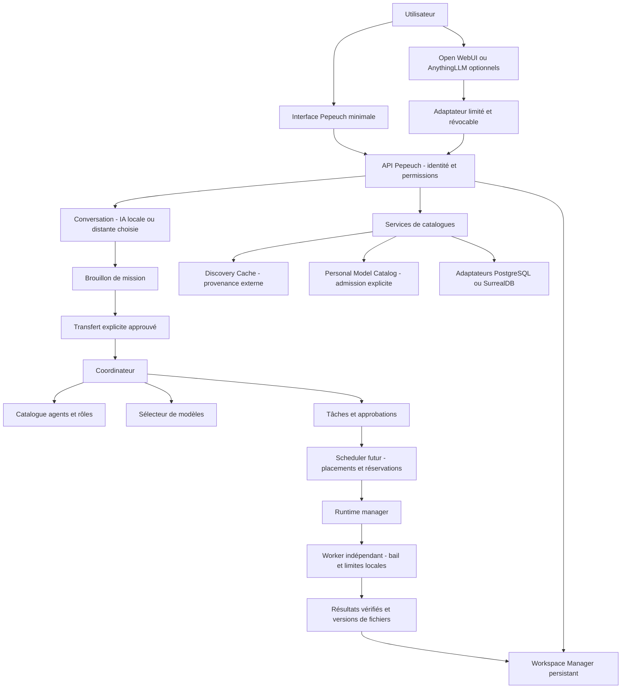

# B5.0 — plan de contrôle Pepeuch

Étude du 27 octobre 2026, sans implémentation. Branche
`feat/webui-control-plane-b5`, créée depuis B4.4 publié
`8ce3a8a23eecf4813c467e01c0c67d08b1eb839d`. Les travaux B4.5 restent sur leur
branche ; aucun code de reprise n'est fusionné dans cette étude.

## Décision proposée

Construire un petit backend Pepeuch indépendant et une interface native minimale
sous la licence du projet. Garder Open WebUI et AnythingLLM comme clients ou
moteurs optionnels derrière des adaptateurs. Employer un **worker Pepeuch
indépendant**, activé volontairement, commun aux trois parcours de déploiement.
Les justifications et limites de licences figurent dans
[l'étude comparative](OPEN_WEBUI_ANYTHINGLLM_STUDY.md).

Le serveur peut vivre dans une VM Proxmox ; un ordinateur personnel rejoint via
une application compagnon, une machine dédiée via USB. Ces parcours ont des rôles
complémentaires, pas trois implémentations du backend. Aucun n'est réalisé ici.
Voir [le provisionnement et l'appairage](NODE_PROVISIONING_DESIGN.md) et
[les espaces persistants](WORKSPACE_MANAGER_DESIGN.md).

Ce diagramme représente une cible. Il ne signifie pas qu'un coordinateur,
un scheduler, un worker ou ces API existent déjà. Le dépôt actuel fournit des
POC de catalogues et une CLI de découverte sur fixtures ; un endpoint MoArk
catalogué n'est pas une inférence testée.

## Responsabilités et contrats proposés

| Frontière | Contrat proposé | Garanties et refus |
| --- | --- | --- |
| UI → backend | API versionnée, identité utilisateur, projet, permissions, identifiant d'opération | Autorisation côté serveur à chaque requête ; aucun accès DB direct ni clé de fournisseur dans le navigateur |
| Conversation → mission | Brouillon avec objectif, extraits explicitement sélectionnés, références de fichiers, politique de données et budget | Bouton « Confier au coordinateur » puis confirmation du périmètre ; pas d'exécution déclenchée par du texte conversationnel |
| Mission → coordinateur | `mission_id`, version du plan, rôles requis, critères d'acceptation, dépenses autorisées | Auto-affectation par capacités par défaut ; override manuel journalisé ; demande d'approbation pour élargir le périmètre |
| Coordinateur → selector | Rôle/capacités, contexte, politiques local/distant, licence et ressources | Candidats justifiés ; inconnu reste inconnu ; aucun modèle nommé obligatoirement en dur |
| Tâche → scheduler | Demande de ressources, dépendances, délai, priorité et politique | Placement et réservations ; le coordinateur ne décide pas arbitrairement des GPU libres |
| Scheduler → runtime | Placement approuvé, artefact/runtime épinglés, enveloppe de ressources et permissions | Démarrage/arrêt contrôlés ; aucune commande shell générale transmise par la conversation |
| Backend → worker | Protocole versionné authentifié, bail borné, tentative et génération de réservation | Rejet d'un bail expiré/rejoué, des ressources interdites et des actions sans consentement local |
| Worker → résultats | `task_id`, `attempt_id`, génération du bail, empreintes des sorties et état | Commit durable et idempotent par le backend ; résultat tardif isolé, pas de succès implicite |

Le modèle conversationnel est choisi par l'utilisateur (local ou distant),
indépendamment du modèle éventuel utilisé pour planifier. Le **coordinateur**
décompose et suit une mission ; le **selector** choisit les modèles, le
**scheduler** place les tâches, le **runtime** exécute, le **worker** applique
les limites de sa machine. Un simple routeur de LLM tiers ne remplace pas ces rôles.

Transitions proposées : brouillon → approuvé → en cours → attente humaine /
interrompu / terminé / échoué. Annuler demande l'arrêt, puis attend un accusé ou
une expiration de bail ; ne pas annoncer un arrêt effectif sur un worker hors ligne.
Réessayer crée une tentative distincte ; les effets non idempotents exigent un
contrôle humain avant répétition. Ces contrats restent à formaliser en schémas.

## Catalogue d'agents et données

Une fiche d'agent référence son origine, sa version, ses rôles/spécialités, son
protocole d'outils, les modèles compatibles, ses licences et conditions d'accès.
Chaque capacité a un état **déclaré / inconnu / vérifié**, sa date, le contexte de
validation et l'exécution justificative. Compatibilité annoncée, benchmark local
et disponibilité instantanée sont des informations différentes. Le choix manuel
ne transforme pas une capacité inconnue en capacité vérifiée.

L'historique relie mission, plan, agent/version, modèle/source/révision, node,
runtime, tentative, autorisations, ressources, fichiers et résultat. Les journaux
sont filtrés ; secrets et conversations privées ne deviennent pas des métadonnées
publiques du Discovery Cache. L'appartenance à un même nom ne fusionne jamais deux
ressources de fournisseurs différents.

Discovery Cache conserve les observations légères et leur provenance. Personal
Model Catalog est un domaine d'admission volontaire, enrichi de compatibilités
et mesures locales. Les références B2 et les cinq types restent distincts :
`model_reference`, `model_artifact`, `agent_resource`, `nim_microservice`,
`inference_endpoint`. L'UI affiche origine, fraîcheur et inconnues, pas une promesse
de téléchargement ou d'inférence. PostgreSQL et SurrealDB sont des adaptateurs
de stockage derrière des services ; ni interface tierce ni worker ne reçoit
leurs identifiants. Aucun schéma existant n'est changé par cette proposition.

## Navigation et double panneau

| Entrée | Contenu visé | Étape |
| --- | --- | --- |
| Tableau de bord | Santé backend, tâche active, validations attendues | MVP |
| Conversations | IA choisie, sessions, brouillons et transfert explicite | V1 ; formulaire de mission au MVP |
| Coordinateur | Plan proposé, affectations, preuves et demandes d'accord | V1 ; suivi manuel au MVP |
| Tâches et workflows | États, tentatives, annulation, dépendances | Tâche simple MVP ; workflows ensuite |
| Espaces de travail | Fichiers, versions, journaux, livrables | MVP minimal |
| Agents | Fiches, rôles, capacités et historique | Un agent déclaré au premier pilote |
| Modèles | Références externes, sélection personnelle, accès/inconnues | Lecture MVP ; enrichissement V1 |
| Nœuds et ressources | Consentement, inventaire, état, réservations | Un worker de test d'abord |
| Bases et catalogues | Statut des adaptateurs, provenance et opérations autorisées | V1, sans console SQL libre |
| Administration | Utilisateurs, appairage, révocation, politiques et audit | Identité/permissions de base MVP |

Le futur double panneau place la conversation à gauche et le plan/les tâches/
fichiers à droite. Le contexte transmis est prévisualisé et réductible ; changer
d'IA n'accorde aucune permission supplémentaire. Le panneau coordinateur continue
de fonctionner si le client conversationnel tiers est absent ou indisponible.
Éviter dix écrans vides au premier démarrage : seules les fonctions disponibles
sont proposées, les suivantes restent dans la feuille de route.

## Lots testables et critères d'entrée

1. **Avant le premier agent** : définir les schémas mission/tâche/bail/résultat,
   l'identité et les permissions, un stockage de workspace hors conteneur et une
   page mission/fichiers/état. Tester un faux worker CPU, les refus d'accès et les
   doublons. Ni chat tiers, GPU, USB, Proxmox automatisé ni scheduler distribué
   ne sont des prérequis à cette tranche.
2. **Premier pilote** : un worker Linux explicitement appairé, un agent et une
   tâche bornée avec résultat persistant ; validation séparée sur machine de test
   autorisée. Échecs, annulation et reboot du worker doivent être visibles.
3. **V1** : appairage compagnon, inventaire vérifié, réservations simples,
   conversation/coordinateur séparés, transferts de fichiers et adaptateur de chat
   optionnel. Matrice réelle par OS avant toute annonce de support.
4. **Ensuite** : workflows multi-workers, politiques avancées, reprise distribuée,
   assistant VM/USB et benchmarks. Chaque provisionneur est un lot distinct à
   confirmer avant toute installation ou action destructive.

Décisions ouvertes : protocole de bail et d'annulation, identité utilisateur,
format d'agent, langage/packaging du worker, stockage durable, politique des modèles
distants, quotas et accès aux documents. Risques dominants : exécution d'outils
non fiables, dépendances UI tierces, perte de fichiers locaux, droits trop larges
sur un ordinateur personnel et confusion entre catalogue et service validé.
