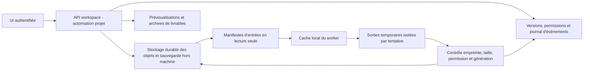

# B5.0 — Workspace Manager persistant

Proposition du 27 octobre 2026. Aucun service, volume, migration ni base réelle
créé. Le workspace appartient au backend Pepeuch, indépendamment du client de
conversation, du moteur LLM, du conteneur et de la disponibilité d'un worker.

## Stockage et propriété

Le premier pilote peut utiliser un volume de fichiers local au serveur, distinct
de sa couche conteneur, et un petit index transactionnel derrière une interface.
Un stockage objet peut suivre sans changer le protocole worker. Choisir ce support
dans un lot validé ; ne pas modifier les bases historiques ni supposer qu'un
partage SMB/NFS ouvert résout les permissions ou la durabilité.

Un workspace est identifié par projet/tenant et un ID opaque. Les fichiers sont
des chemins logiques et des versions référençant des objets immuables par empreinte.
Le journal associe auteur utilisateur/agent, mission, tentative, node, date,
version précédente et permission utilisée. L'historique n'est pas seulement le
stdout d'un conteneur. Les secrets de connexion restent dans un service dédié,
hors arborescence, logs, archives et index de recherche.

Les documents RAG d'AnythingLLM et les fichiers de conversation d'Open WebUI ne
deviennent pas automatiquement le workspace. Import/export explicite et vérifié,
avec provenance, permissions et versions ; aucun couplage à leur schéma interne.
La conversation ne transmet au coordinateur que les références de fichiers et
extraits approuvés. Aucune transmission distante implicite d'un dossier entier.

## Contrats d'accès proposés

| Opération | Entrées/sorties | Règles |
| --- | --- | --- |
| Créer/lister un workspace | Projet autorisé, ID opaque et métadonnées publiques | Isolation tenant/projet et pagination ; ne pas révéler l'existence des autres projets |
| Lister/prévisualiser | Chemin logique, version, type/taille ; représentation bornée | Permission lecture, quotas ; HTML/SVG non fiable rendu isolé, pas de script actif ni de suivi externe |
| Téléverser | Session bornée, taille/type/empreinte attendus | Staging temporaire, vérification serveur de l'empreinte, publication explicite ; un hash fourni par le client n'est pas une preuve |
| Télécharger | Objet/version autorisés, durée et taille bornées | Pas d'URL arbitraire ni de traversée de chemin ; éventuel lien signé limité à cet objet et cette permission |
| Modifier/publier | Version de base et identifiant d'opération | Contrôle optimiste de version ; conflit présenté, jamais écrasement silencieux |
| Exporter un livrable | Manifeste figé des versions, archive et empreinte | Ne pas inclure secrets/logs privés par défaut ; permissions revalidées au téléchargement |
| Journal/historique | Événements liés à une mission et une tentative | Accès auditable, filtrage des secrets et rétention déclarée |
| Fournir à un worker | Manifeste d'entrées, bail, droits et limites | Copie lecture seule, pas de montage général du domicile/partage serveur |
| Retourner un résultat | Objets temporaires + manifeste de sorties | Le backend vérifie et commit ; le worker ne publie pas directement dans le projet |

Normaliser les chemins logiques sans les convertir en chemins hôte fournis par
l'utilisateur : refuser absolus, `..`, liens sortants, fichiers spéciaux et noms
ambigus entre OS. À préciser : casse Windows/macOS, Unicode, noms réservés, longueur
et collisions. Archives entrantes : refus des traversées/liens, quotas de nombre,
taille décompressée et profondeur contre les bombes ; aucun extracteur général
lancé avec des privilèges d'administration.

Chaque tâche reçoit un sous-ensemble d'entrées et un espace de sortie isolé.
Permissions lecture/écriture/outils/sorties réseau bornées par la mission et le
consentement du propriétaire du worker. Les identifiants de bases de production
ne sont pas fournis aux agents. Une action administrative ou destructive exige
une autorisation distincte, vérifiée par le backend, pas déduite d'une réponse LLM.

## Reprise et transfert entre nœuds

Le backend émet un manifeste d'entrées avec versions et empreintes ; le worker
télécharge uniquement les objets autorisés et vérifie les octets. Son cache est
une optimisation jetable, pas l'unique copie. Par défaut, les transferts passent
par le backend via TLS et autorisation projet ; le pair-à-pair est différé jusqu'à
définition d'une délégation sûre et de son audit.

Les sorties arrivent en staging par tentative. Elles deviennent visibles ensemble
après vérification de complétude, tailles/empreintes, bail et génération. La réponse
« résultat accepté » vient après publication durable. Une interruption avant
commit laisse la dernière version du projet intacte ; une répétition du même
identifiant d'opération retourne le même résultat, sans écrasement ni duplication.
Les résultats d'une ancienne tentative sont isolés jusqu'à décision explicite.

Après panne d'un worker, les entrées et livrables déjà validés survivent. Un résultat
qui n'a jamais quitté un disque en panne ne peut être garanti : l'UI distingue
« calcul terminé localement », « transfert en cours » et « livrable durable validé ».
La destruction du conteneur n'efface pas les objets serveur. Pour reprendre ailleurs,
créer une nouvelle tentative depuis les entrées figées ; ne pas rejouer implicitement
des effets externes non idempotents. Checkpoints de calcul propres aux runtimes
exigent un contrat séparé des checkpoints de métadonnées du Discovery Cache.

## Rétention, sauvegarde et premier lot

Politiques séparées pour objets de projet, caches workers, staging abandonné,
logs et sauvegardes. Aucun nettoyage ne doit effacer un objet encore référencé
par une version ou une tâche ; la suppression d'un projet est une action humaine
autorisée avec politique de conservation explicite. Quotas et saturation disque
font échouer proprement une publication avant perte d'un ancien livrable.
La rétention ne constitue pas une sauvegarde : prévoir copie hors serveur et
restauration cohérente de l'index et des objets, avec vérification des références.

Premier lot : un utilisateur/projet, fichiers upload/download, versions immuables,
quota, journal minimal et volume persistant ; vérifier les refus inter-projets,
rejeu/conflit, interruption de transfert et redémarrage du backend avec un faux
worker. V1 : aperçus sûrs, archives, reprise des transferts et permissions avancées.
Ensuite : réplication, chiffrement par projet, recherche et cache pair-à-pair.
Les sauvegardes et le retrait d'un worker sont testables sans aucun agent réel.

Décisions ouvertes : index transactionnel et format des objets, chiffrement et
gestion de clés, limites et rétention par tenant, publication multi-fichiers,
modèle d'ACL, formats de prévisualisation et critères de sauvegarde/restauration.
Toutes ces fonctions sont proposées ; aucun accès PostgreSQL/SurrealDB n'est réalisé.
