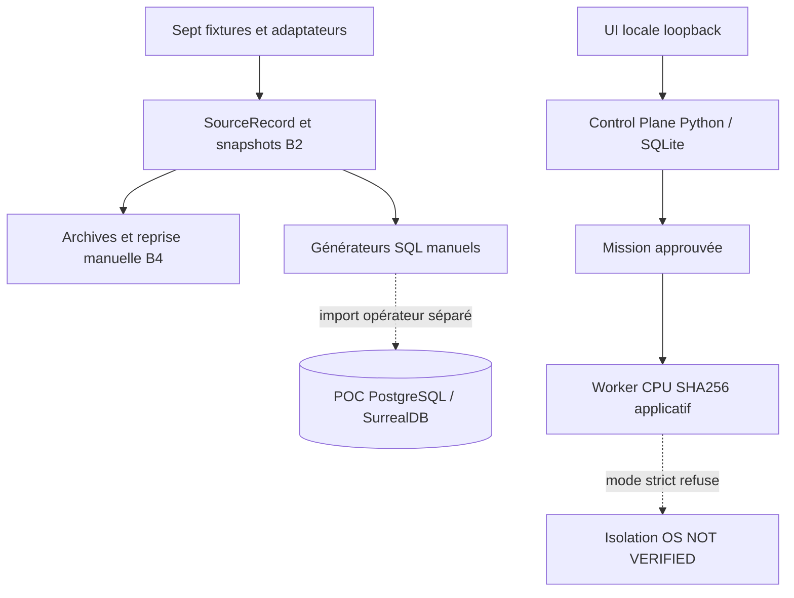
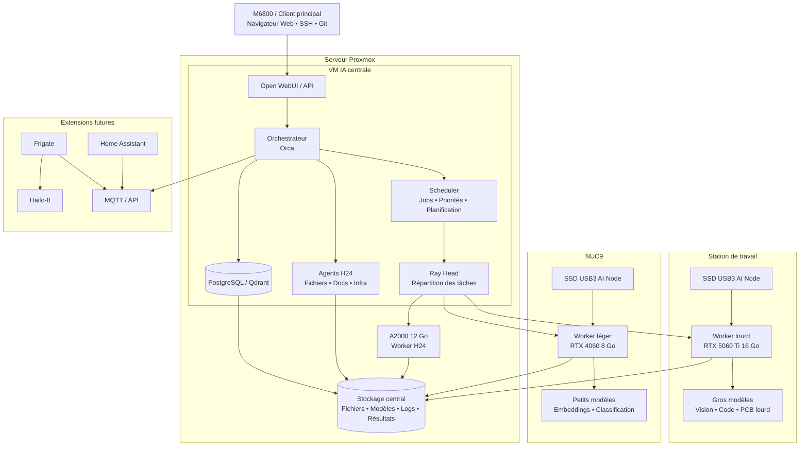

# Schéma global de l’architecture

## État réel au 28 octobre 2026

Les fondations Discovery et Control Plane sont testées séparément. La chaîne
complète catalogue personnel → sélection → scheduler → runtimes reste une cible,
pas un service distribué déployé. Aucune fusion d’identité entre plateformes.



Les deux POC sont actuellement arrêtés sur VM150 et leurs données préservées.
Le GPU invité est disponible ; inférence, calcul CUDA Docker et worker GPU
sécurisé ne sont pas validés par ce constat. Le cache Discovery et le catalogue
personnel restent distincts ; les scripts de génération SQL n’ouvrent pas de
connexion DB. Voir [audit et dépendances](../audit/PHASES_0_3_COVERAGE.md),
[contrats Discovery](../../database/poc/MANUAL_INCREMENTAL_RUN.md) et
[audit B5.3.1](B531_SECURITY_AUDIT.md).

## Ancienne cible matérielle — historique, non déployée

Les schémas ci-dessous conservent la première proposition. Orca, Ray, Qdrant,
Open WebUI et les agents H24 ne sont pas des composants validés du prototype
actuel. Les choix de moteurs/interfaces et l’activation des workers multi-OS
restent soumis aux lots et décisions de la roadmap.

### Version Mermaid historique



## Version texte simple

```text
                           ┌──────────────────────────────┐
                           │       M6800 / Client         │
                           │    Web UI • SSH • Git        │
                           └──────────────┬───────────────┘
                                          │
                                          ▼
                    ┌────────────────────────────────────────────┐
                    │            Serveur Proxmox                 │
                    │                                            │
                    │  ┌──────────────────────────────────────┐  │
                    │  │            VM IA centrale            │  │
                    │  │                                      │  │
                    │  │  Orca / Orchestrateur               │  │
                    │  │  Scheduler / Jobs / Priorités       │  │
                    │  │  Ray Head                           │  │
                    │  │  Open WebUI / API                   │  │
                    │  │  PostgreSQL / Qdrant                │  │
                    │  │  Agents H24                         │  │
                    │  └──────────────────────────────────────┘  │
                    │                    │                        │
                    │                    ▼                        │
                    │          A2000 12 Go / Worker H24          │
                    │                    │                        │
                    │                    ▼                        │
                    │    Stockage central : fichiers / modèles   │
                    │       logs / jobs / résultats / index      │
                    └───────────────┬─────────────────────┬───────┘
                                    │                     │
                                    │                     │
                                    ▼                     ▼
                    ┌────────────────────────┐   ┌────────────────────────┐
                    │   Station de travail   │   │          NUC9          │
                    │  SSD USB3 AI Node      │   │   SSD USB3 AI Node     │
                    │  RTX 5060 Ti 16 Go     │   │   RTX 4060 8 Go        │
                    │  Worker lourd          │   │   Worker léger         │
                    │  Gros modèles          │   │   Petits modèles       │
                    └────────────────────────┘   └────────────────────────┘

Extensions futures :
Frigate → Hailo-8 → MQTT/API → Orchestrateur
Home Assistant → MQTT/API → Orchestrateur
```

## Lecture rapide

- **M6800** : poste de pilotage.
- **Serveur Proxmox** : cœur du système.
- **VM IA** : orchestration, scheduling, base de données, API, agents permanents.
- **A2000** : worker H24 pour les tâches permanentes et légères/moyennes.
- **Station 5060 Ti** : worker lourd à la demande.
- **NUC9 4060** : worker léger pour tâches parallèles.
- **Stockage central** : source unique des fichiers, modèles, logs et résultats.
- **Frigate / Hailo / Home Assistant** : extensions futures via MQTT/API.
