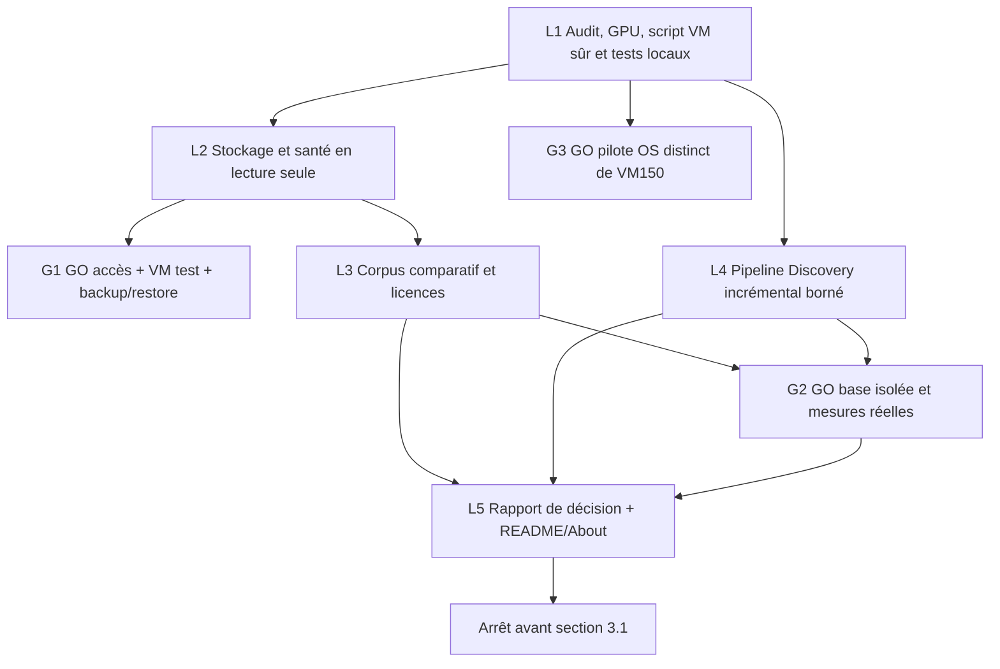

# Audit de couverture — phases 0 à 3 générales

**Reprise depuis main `5ead575` sur `feat/phases-0-3-integrity-cas` : 34 cases
initiales encore ouvertes, une clôture documentaire T20.** Classement des 35 :
[matrice de reprise](PHASES_0_3_CLASSIFICATION_20261028.md). Les décomptes à 35
ci-dessous sont les checkpoints historiques, conservés avec leurs preuves.
Intégrité, provenance et CAS opt-in : 615 tests locaux, concurrence et reprises
qualifiées réellement sur nouvelles bases synthétiques des deux moteurs,
sans restauration ou benchmark. [Contrat et preuves](../../database/poc/INTEGRITY_CAS_PHASE3.md).
Aucune CLI de production, isolation comptes/domaines ou révision fournisseur
n’est validée par ces seuls résultats ; les grandes lignes composites restent ouvertes.

**Lot suivant provenance/HTTP : 644 tests locaux réussis**, dont 29 nouveaux.
Autorité en mémoire à grants exacts, publication/reprise sous confiance courante,
GET conditionnel injecté budgété et liaison HTTP signée distincte de B4.
T14/T15 progressent sans clôture : gestion durable des clés, CLI et politiques
fournisseur restent ouvertes. Toujours **34 cases initiales ouvertes**.
[Contrat](../../database/poc/PROVENANCE_HTTP_PHASE3.md),
[checkpoint courant](CHECKPOINT_20261028_PROVENANCE_HTTP.md).

Date : 28 octobre 2026. Base `d9180f6`, arbre initial propre ; branche
`feat/todo-phases-0-3`. Lecture intégrale de TODO et README ; examen des scripts,
Compose, ADR et contrats B2/B4/B5. La borne est **avant `## 3.1 models.dev`**.
Les références Lxxx ci-dessous désignent les lignes de la TODO à cette base.
La suite du fichier sera préservée octet par octet. Aucun push/merge/main modifié.

**État courant après le banc isolé autorisé** : cinq lignes de phase 2
supplémentaires clôturées, **35 cases ouvertes** avant 3.1. Les deux POC
historiques restent arrêtés ; les deux nouveaux conteneurs du banc ont été arrêtés
en fin d’essai, données/exports conservés. G2 est levé uniquement pour ce banc
synthétique, pas pour la production ou le pilote OS. [Résultats détaillés](../../database/poc/ISOLATED_DOCKER_BENCH.md).

**Reprise du 28/10 après checkpoint** : 35 lignes composites toujours ouvertes.
La protection des imports B2 régénérés contre l’antériorité et les conflits au
même instant est désormais **VERIFIED sur les deux moteurs synthétiques** ;
une sous-tâche dédiée est clôturée. Les vieux SQL restent non protégés. Les dates
ne prouvent pas les révisions fournisseur et ne remplacent pas un writer CAS
cloisonné. [Contrat et preuves](../../database/poc/REPLAY_GUARD_PHASE3.md).
Les descriptions « legacy inchangé » ci-dessous sont des constats antérieurs,
conservés pour l’audit. Aucune donnée ou mesure historique n’est réécrite.
État détaillé des 35 lignes et de leurs blocages :
[checkpoint de reprise](CHECKPOINT_20261028_REPRISE_PHASES_0_3.md).

## États

`IMPLEMENTED` = code/config présent ; `TESTED` = tests correspondants passés ;
`VERIFIED` = preuve adaptée au résultat (préciser rapport utilisateur ou mesure) ;
`PARTIAL` = seulement une partie de la ligne composite réalisée ; `BLOCKED` =
accès/autorisation/décision requis ; `NOT VERIFIED` = preuve réelle absente.
Une fixture ne valide ni une base distante, ni un GPU, ni une restriction OS.

## Inventaire initial exhaustif

49 cases ouvertes : phase 0 **0**, phase 1 **38** (checkpoints compris), phase 2
**9**, phase 3 générale **2**. Les sept lignes GPU/résolution VFIO ci-dessous
correspondent à six opérations et un doublon historique, pas sept validations
matérielles différentes. Les lignes composites restent ouvertes si un volet manque.

| TODO initiale | État constaté | Preuve existante | Travail restant | Priorité / lot |
|---|---|---|---|---|
| L115 — Créer la VM via le script Proxmox | BLOCKED | `infrastructure/proxmox/create-ai-vm.sh` existe ; aucun essai hyperviseur prouvé | Durcir/préparer le plan et les tests locaux, puis essai sur VMID jetable distinct de 150 après GO | P0 — L1 / G1 |
| L117 — Passer la RTX A2000 en passthrough | VERIFIED (rapport utilisateur) | Mission du 28/10 : passthrough, lspci, driver, nvidia-smi, Toolkit et Docker ; checkpoint GPU à enregistrer | Cocher les six cases GPU et la résolution VFIO ; ne pas extrapoler CUDA Docker/inférence/stress | P0 — L1 |
| L118 — Vérifier `lspci` | VERIFIED (rapport utilisateur) | Mission du 28/10 : passthrough, lspci, driver, nvidia-smi, Toolkit et Docker ; checkpoint GPU à enregistrer | Cocher les six cases GPU et la résolution VFIO ; ne pas extrapoler CUDA Docker/inférence/stress | P0 — L1 |
| L119 — Installer le driver NVIDIA | VERIFIED (rapport utilisateur) | Mission du 28/10 : passthrough, lspci, driver, nvidia-smi, Toolkit et Docker ; checkpoint GPU à enregistrer | Cocher les six cases GPU et la résolution VFIO ; ne pas extrapoler CUDA Docker/inférence/stress | P0 — L1 |
| L120 — Vérifier `nvidia-smi` | VERIFIED (rapport utilisateur) | Mission du 28/10 : passthrough, lspci, driver, nvidia-smi, Toolkit et Docker ; checkpoint GPU à enregistrer | Cocher les six cases GPU et la résolution VFIO ; ne pas extrapoler CUDA Docker/inférence/stress | P0 — L1 |
| L121 — Installer NVIDIA Container Toolkit | VERIFIED (rapport utilisateur) | Mission du 28/10 : passthrough, lspci, driver, nvidia-smi, Toolkit et Docker ; checkpoint GPU à enregistrer | Cocher les six cases GPU et la résolution VFIO ; ne pas extrapoler CUDA Docker/inférence/stress | P0 — L1 |
| L122 — Vérifier le GPU depuis Docker | VERIFIED (rapport utilisateur) | Mission du 28/10 : passthrough, lspci, driver, nvidia-smi, Toolkit et Docker ; checkpoint GPU à enregistrer | Cocher les six cases GPU et la résolution VFIO ; ne pas extrapoler CUDA Docker/inférence/stress | P0 — L1 |
| L125 — Définir volumes persistants | PARTIAL | Deux Compose persistants ; PG volume nommé et SurrealDB bind, redémarrages documentés | Formaliser stockage, propriétés, rétention et frontières de sauvegarde sans changer les volumes | P1 — L2 |
| L126 — Définir sauvegarde de la VM | BLOCKED | Arborescence backups présente ; aucune restauration Proxmox VM150 prouvée | Inventaire et plan backup/restore vers nouveau VMID, espace/stockage et GO opérateur | P0 — G1 |
| L127 — Ajouter healthchecks de base | IMPLEMENTED / NOT VERIFIED runtime | Healthchecks pg_isready et /surreal is-ready dans les Compose | Tester le contrat local et confirmer l’état réel sur la VM ; ne pas confondre config et service healthy | P1 — L2 / G1 |
| L138 — Définir et vérifier une sauvegarde/restauration Proxmox de la VM 150 avant d'y stocker des données irremplaçables. | BLOCKED | Arborescence backups présente ; aucune restauration Proxmox VM150 prouvée | Inventaire et plan backup/restore vers nouveau VMID, espace/stockage et GO opérateur | P0 — G1 |
| L139 — Vérifier les healthchecks de l'ensemble des services (SurrealDB confirmé `Healthy` ; état `healthy` de PostgreSQL encore à confirmer). | BLOCKED | SurrealDB Healthy rapporté ; PostgreSQL healthy encore non confirmé | Accès VM150 en lecture seule, preuve des deux états puis contrôle de persistance approuvé | P1 — G1 |
| L140 — Reprendre le passthrough RTX A2000 : échec VFIO/FLR (`stuck in D3`), validation GPU dans la VM reportée ; ne pas bloquer le POC CPU. | VERIFIED (rapport utilisateur) | Mission du 28/10 : passthrough, lspci, driver, nvidia-smi, Toolkit et Docker ; checkpoint GPU à enregistrer | Cocher les six cases GPU et la résolution VFIO ; ne pas extrapoler CUDA Docker/inférence/stress | P0 — L1 |
| L151 — Étendre les sondes à plusieurs modèles et formats ; vérifier les révisions, fichiers, relations et éventuelles restrictions d'accès. L'API sondée ne fournit pas de SHA Git exploitable. | BLOCKED (limite de périmètre) | POC ciblés B3.1/B3.2/B3.3 validés, extensions non faites | Inventorier seulement ; extensions propres aux sources et autres ressources attendent le GO des sections 3.1+ | P2 — G4 |
| L161 — Étendre les sondes à d'autres dépôts et étudier séparément les ressources datasets, spaces, MCP, skills et les modèles servis par l'AI Gateway. | BLOCKED (limite de périmètre) | POC ciblés B3.1/B3.2/B3.3 validés, extensions non faites | Inventorier seulement ; extensions propres aux sources et autres ressources attendent le GO des sections 3.1+ | P2 — G4 |
| L171 — Synchroniser les fichiers locaux non suivis de la VM avec la branche publiée, après comparaison ; voir la procédure ciblée. | BLOCKED | `database/poc/MOARK_VM_SYNC.md` ; fichiers locaux VM non comparés ici | Comparer en lecture seule avant toute synchronisation/stash/pull ; accès et autorisation ciblée nécessaires | P1 — G1 |
| L172 — Étudier séparément capacités, quotas applicables et dépôts de poids MoArk/Gitee ; aucune association automatique par nom. | BLOCKED (limite de périmètre) | POC ciblés B3.1/B3.2/B3.3 validés, extensions non faites | Inventorier seulement ; extensions propres aux sources et autres ressources attendent le GO des sections 3.1+ | P2 — G4 |
| L184 — Décider la sémantique future des accès/visibilités, de l'isolation domaines/comptes, des révisions et des collectes partielles avant toute évolution de format ou d'identité. | PARTIAL / décision nécessaire | B4.0/B4.1 et cache B4.5 : clés B2 et inconnues conservées | Fixer des politiques additives, publiques et cloisonnées ; ne pas changer les identités ou déduire des licences | P1 — L4 / G4 |
| L200 — Décider et tester la politique de redirections B1 avant sa migration ; préserver le cas NIM 404 et les limites du SDK. Voir TRANSPORT_B42.md. | PARTIAL | Transport B4.2 refuse redirects ; B1 legacy les suit ; tests NIM 404 et interface SDK | Documenter/tester une politique opt-in sans migration silencieuse du legacy ni promesse de budget SDK opaque | P1 — L4 |
| L208 — Examiner le prototype et décider multitag NIM, namespaces domaines/comptes, provenance synthétique/réelle et conventions de collecte partielle avant un registre opérationnel. | PARTIAL | Registre manuel des sept sources et CLI fixtures, références B3.3 figées | Contrat contrôlé de collecte/reprise et provenance ; multitag et namespaces nouveaux restent différés | P1 — L4 / G4 |
| L217 — Examiner le registre manuel avant toute extension online ; provenance synthétique/réelle, domaines/comptes, NIM multitag et résultats partiels restent à décider. | PARTIAL | Registre manuel des sept sources et CLI fixtures, références B3.3 figées | Contrat contrôlé de collecte/reprise et provenance ; multitag et namespaces nouveaux restent différés | P1 — L4 / G4 |
| L227 — Décider la provenance obligatoire et le contrat d'import avant toute protection complète du B2 brut ; l'option ne remplace pas une validation d'origine. | PARTIAL | Provenance B4.5 et génération protégée opt-in ; legacy brut reste compatible | Éviter tout repli implicite, séparer synthétique/historique/contrôlé et protéger le chemin nouveau | P1 — L4 |
| L237 — Définir l'enrôlement/rotation/révocation des émetteurs et la CLI protégée ; HMAC local ne prouve pas une collecte distante. | PARTIAL | HMAC local B4.5, pas de gestion d’émetteurs ni CLI protégée | Enrôlement/rotation/révocation locaux et génération opt-in sans clé en argument/log/snapshot | P1 — L4 |
| L238 — Raccorder les reçus HTTP conditionnels au moteur budgété, la reprise inter-sources et les politiques de fraîcheur avant de déclarer B4.5 opérationnel. | PARTIAL | Cache/reuse 304 et checkpoints atomiques isolés du moteur B4.4 | Raccorder de façon testable budgets/revalidation/reprise inter-sources/fraîcheur, conserver chaque observation | P1 — L4 |
| L239 — Définir pagination distante, garanties/quotas SDK, concurrence par hôte et budget global dans des lots séparés ; aucun scheduler. | BLOCKED / PARTIAL | Budgets coopératifs par source, absence de pagination distante/concurrence/global | Borner le lot général ; pagination/SDK réels demandent contrats et validation ciblés sans collecte globale | P2 — L4 / G4 |
| L248 — Valider les contrats d'identité/appairage/bail et l'API de mission avant B5.1 ; développer un faux worker puis autoriser séparément un pilote Linux CPU. | PARTIAL | Mission/bail local, faux worker et epochs testés B5.1–B5.3.1 | Appairage/TLS et pilote CPU OS distinct non validés ; ne pas cocher toute la ligne composite | P2 — G3 / G4 |
| L249 — Choisir langage/packaging, stockage durable et politique de clés ; vérifier licences/artefacts exacts, notamment Desktop avant toute redistribution. | PARTIAL / décision nécessaire | Python standard + SQLite locaux testés ; étude interfaces disponible | Distinguer choix prototype et packaging production ; artefacts Desktop exacts avant redistribution | P2 — G4 / L5 |
| L250 — Établir une matrice réellement testée par OS/runtime ; aucune capacité GPU/inférence/agent annoncée comme vérifiée par cette étude. | BLOCKED | Linux local testé ; aucune matrice OS/runtime distribuée | Machines Windows/macOS/Linux dédiées et autorisation des essais ; pas de capacités matérielles inventées | P2 — G3 / G4 |
| L251 — Garder interfaces tierces, VM automatisée, compagnon multi-OS et USB dans des lots séparés ; aucune installation/provisionnement/migration effectués dans B5.0. | PARTIAL (règle respectée) | Interfaces optionnelles/provisionnement/USB restent séparés dans les études B5.0 | Conserver la séparation ; ces livraisons futures ne sont pas validées par l’absence de déploiement | P2 — G4 |
| L263 — Finaliser la pile HTTP de production et l'isolation OS d'un vrai worker ; les contrôles locaux HTTP/identité/sauvegarde sont validés au checkpoint B5.2, sans exposition LAN. | PARTIAL / BLOCKED OS | HTTP local durci et API persistante testés ; B5.3.1 strict toujours deny | Pile production et qualification OS, pas d’essai sensible sur VM150 | P0 — G3 / G4 |
| L264 — Définir les contrats agents/rôles/baux réels, appairage/TLS et politiques multi-utilisateurs avant une ouverture LAN ou exécution d'outils ; aucune installation, inférence ou collecte réelle dans B5.1. | BLOCKED (décisions et portée) | Contrats de conception et CPU SHA256 borné seulement | Agents réels, entrées/outils, PKI, multi-utilisateurs et profils OS futurs hors activation ; GO distinct | P2 — G3 / G4 |
| L276 — Avant un vrai worker : isolation OS éprouvée, politiques réseau/outils/enfants, PKI/appairage/TLS et pile HTTP de production ; conserver le prototype sans IA réelle ni découverte LAN. | PARTIAL / BLOCKED OS | HTTP local durci et API persistante testés ; B5.3.1 strict toujours deny | Pile production et qualification OS, pas d’essai sensible sur VM150 | P0 — G3 / G4 |
| L286 — Autoriser puis exécuter les tests négatifs OS sur une machine distincte : UID/groupes, secrets/SQLite/objets inaccessibles, FS, réseau, GPU/Docker, CPU/RAM/PID, runtime et arrêt des enfants — **NOT VERIFIED**. | BLOCKED | Banc B5.3.1 préparé, aucune preuve OS réelle | VM jetable expressément autorisée ; comptes/unité/pare-feu séparément approuvés | P0 — G3 |
| L287 — Qualifier le producteur indépendant de permis et fermer/vérifier le réseau OS au port backend ; contrats, observations et canal de refus ajoutés en B5.3.1, sans activation. `--application-test` ne valide pas l'isolation, le filtre IP candidat seul autorise tous les ports loopback. | PARTIAL / BLOCKED OS | Contextes/protocoles/guards testés ; contrôleur root livré seulement deny | Qualifier collecte indépendante, compte/code/FD/ports/ressources et producteur de permis après pilote | P0 — G3 |
| L288 — Avant une inférence ou un outil réel : contrat de lecture des versions d'entrée, quotas cumulés I/O/calcul, politique des moteurs/outils, preuves OS et profils Windows/macOS distincts ; conserver AnythingLLM/Open WebUI facultatifs. | BLOCKED (décisions et portée) | Contrats de conception et CPU SHA256 borné seulement | Agents réels, entrées/outils, PKI, multi-utilisateurs et profils OS futurs hors activation ; GO distinct | P2 — G3 / G4 |
| L298 — Autoriser un pilote négatif sur une **VM jetable distincte** selon le plan opérateur Debian, avec confirmations séparées pour comptes, fichiers, unités et pare-feu. Aucun accès à la VM historique autorisé. | BLOCKED | Banc B5.3.1 préparé, aucune preuve OS réelle | VM jetable expressément autorisée ; comptes/unité/pare-feu séparément approuvés | P0 — G3 |
| L299 — Qualifier collecte indépendante, compte exclusif, code/FD/montages, règles/IPv4/IPv6/ports et ressources/arrêt avant un producteur de permis positif. Le contrôleur livré émet toujours `deny` ; strict reste bloqué, OS **NOT VERIFIED**. | PARTIAL / BLOCKED OS | Contextes/protocoles/guards testés ; contrôleur root livré seulement deny | Qualifier collecte indépendante, compte/code/FD/ports/ressources et producteur de permis après pilote | P0 — G3 |
| L300 — Définir si nécessaire une attestation serveur distincte : aucun champ worker ne promeut aujourd'hui le statut `verified`. Pas de vraie inférence, modèle, GPU ou service privilégié permanent. | BLOCKED / décision nécessaire | Le backend refuse toute promotion verified fournie par le worker | Décider d’une attestation serveur distincte avant un statut matériel positif ; aucune inférence | P2 — G3 / G4 |
| L320 — Comparer les moteurs sur les **mêmes requêtes représentatives**, index et mesures de performance ; aucun choix arrêté. | PARTIAL / BLOCKED mesures | 14 requêtes en parité rapportées ; pas de graphe/vecteurs/plans/mesures comparables | Corpus/requêtes/harness reproductibles puis exécution isolée avec GO ; ne pas comparer temps Docker exec | P1 — L3 / G2 |
| L322 — Finaliser le POC comparatif **PostgreSQL vs SurrealDB** (performances, graphe, vecteurs et contraintes d'exploitation). | PARTIAL / BLOCKED mesures | 14 requêtes en parité rapportées ; pas de graphe/vecteurs/plans/mesures comparables | Corpus/requêtes/harness reproductibles puis exécution isolée avec GO ; ne pas comparer temps Docker exec | P1 — L3 / G2 |
| L324 — Tester les requêtes représentatives : | PARTIAL / BLOCKED mesures | 14 requêtes en parité rapportées ; pas de graphe/vecteurs/plans/mesures comparables | Corpus/requêtes/harness reproductibles puis exécution isolée avec GO ; ne pas comparer temps Docker exec | P1 — L3 / G2 |
| L330 — Tester la recherche vectorielle / hybride | PARTIAL / BLOCKED mesures | 14 requêtes en parité rapportées ; pas de graphe/vecteurs/plans/mesures comparables | Corpus/requêtes/harness reproductibles puis exécution isolée avec GO ; ne pas comparer temps Docker exec | P1 — L3 / G2 |
| L331 — Tester relations de graphe et liens typés | PARTIAL / BLOCKED mesures | 14 requêtes en parité rapportées ; pas de graphe/vecteurs/plans/mesures comparables | Corpus/requêtes/harness reproductibles puis exécution isolée avec GO ; ne pas comparer temps Docker exec | P1 — L3 / G2 |
| L333 — Tester Docker et consommation mémoire | PARTIAL / BLOCKED mesures | 14 requêtes en parité rapportées ; pas de graphe/vecteurs/plans/mesures comparables | Corpus/requêtes/harness reproductibles puis exécution isolée avec GO ; ne pas comparer temps Docker exec | P1 — L3 / G2 |
| L334 — Vérifier précisément les contraintes de licence de SurrealDB avant adoption | PARTIAL | ADR0003 ne tranche pas ; licence exacte SurrealDB à vérifier | Sources officielles et version 3.3.4, distinguer moteur/SDK, conditions d’usage et artefact réel | P1 — L3 |
| L335 — Décider du moteur principal | BLOCKED décision finale | Choix expressément non figé ; métriques représentatives absentes | Rapport argumenté et recommandation conditionnelle ; décision finale après preuves/contraintes approuvées | P1 — L3 / G2 / G4 |
| L336 — Documenter la décision | BLOCKED décision finale | Choix expressément non figé ; métriques représentatives absentes | Rapport argumenté et recommandation conditionnelle ; décision finale après preuves/contraintes approuvées | P1 — L3 / G2 / G4 |
| L374 — Industrialiser l'ingestion incrémentale (exécution planifiée, reprise sur erreur, rétention, surveillance) ; le POC B2 est une importation **manuelle**, pas encore un Discovery Service en production. | PARTIAL | B2 imports idempotents ; B4 budgets/provenance/checkpoints ; pas de service intégré | Pipeline incrémental additif, collecte partielle/reprise/rétention/erreurs/imports échoués, validation DB ciblée | P1 — L4 / G2 |
| L383 — Éprouver les imports partiellement échoués, les changements de révision réels et les variations de périmètre ; conserver les snapshots et définir la politique de rafraîchissement. | PARTIAL | B2 imports idempotents ; B4 budgets/provenance/checkpoints ; pas de service intégré | Pipeline incrémental additif, collecte partielle/reprise/rétention/erreurs/imports échoués, validation DB ciblée | P1 — L4 / G2 |

## Dépendances et lots

- **L1** : checkpoint GPU daté et corrections des cases réellement prouvées ;
  plan offline et tests simulés du script Proxmox, refus d’écrasement. Ce n’est
  pas une validation Proxmox réelle.
- **L2** : politique des volumes/sauvegardes, inspection Docker strictement en
  lecture seule et preuves testées de configuration. Ne pas recréer les POC.
- **L3** : corpus de relations/graphes/vecteurs et méthode mesurable commune,
  sources officielles des licences, protocole/rapport distinguant attentes et
  résultats réels. Pas de décision de performance basée sur une simulation.
- **L4** : primitives générales additives, CLI manuelle sûre, provenance,
  snapshots immuables, budgets, fraîcheur, reprise/partiels et protections
  d’import. Réutiliser B4 ; aucun nouveau connecteur source ou collecte globale.
- **L5** : bilan vérifié, décision conditionnée aux mesures, améliorations
  README/About proposées sans changer le About GitHub sans validation.

Les gates ne sont pas des succès locaux :

- **G1** : accès Proxmox/VM150 ; nouveau VMID, backup/restore vers ID distinct,
  stockage disponible et plan de retour arrière. Aucune restauration sur VM150.
- **G2** : mesures et imports/échecs dans une base/namespace de test explicitement
  approuvé ; aucune migration/suppression des POC historiques.
- **G3** : pilote OS B5.3.1 sur VM jetable séparée ; permissions comptes,
  unité et pare-feu expressément approuvées. GPU opérationnel ≠ worker isolé.
- **G4** : décisions de sémantique et chapitres futurs. Les extensions spécifiques
  aux sources 3.1+ et les interfaces/agents multi-OS ne sont pas commencés via
  un ancien checkpoint de phase 1. Les identifier n’autorise pas leur activation.

## Constat d’accès actuel

Le Docker local est lisible sous l’UID courant hors sandbox, moteur 29.9.1,
mais ne contient que des builders, pas les deux POC de la VM150. Il ne s’agit
**pas** du moteur Docker 29.9.2 rapporté pour cette VM. Aucun `qm`, `psql` ou
binaire SurrealDB local. Aucun accès SSH cible n’avait été fourni au début.
Le 28/10, l’utilisateur a autorisé la lecture seule de `pepeuch@192.168.10.191`
et du Proxmox `192.168.10.11`. Les tentatives non interactives avec clés existantes
(`pepeuch` sur VM150, `root` sur Proxmox) sont refusées :
`Permission denied (publickey,password)`. Aucun autre compte/moyen, agent QEMU,
changement d’authentification ou récupération de credentials n’a été tenté.
L’utilisateur a ensuite fourni un mot de passe limité à **VM150** : connexion
`pepeuch` réussie, lectures Docker via sudo. [Inventaire réel](../infrastructure/VM150_READONLY_20261028.md).
GPU/versions/montages et exports présents confirmés ; **les deux bases sont
arrêtées**, health enregistré `unhealthy`. Les cinq dernières sondes de chaque
base réussissaient avant cet arrêt : readiness historique désormais prouvée.
Aucun démarrage, requête SQL ou test sur leurs données. Proxmox reste BLOCKED ;
la dernière instruction interdit tout accès supplémentaire à cet hôte. Aucun
environnement jetable autorisé. Aucun secret dans les fichiers.

## Bilan des lots locaux avant autorisation du banc

| Lot | Réalisation | Limite / état final |
|---|---|---|
| L1 | Plan VM offline, VM150 protégée, pas d’écrasement image/snippet, sélection unique du disque importé, corrections cloud-init ; tests avec commandes simulées | IMPLEMENTED / TESTED ; vraie création Proxmox BLOCKED |
| L2 | Inspecteur Docker ps/inspect sans secrets, politique des volumes et plans backup/restore ; montages réellement observés sur VM150 | Volumes définis VERIFIED ; disponibilité DB, restore et stress NOT VERIFIED |
| L3 | Corpus synthétique relations/graphe/vecteurs/hybride, oracles littéraux, validateur de rapports comparables, licence exacte du tag SurrealDB | IMPLEMENTED / TESTED hors ligne ; traductions/requêtes moteur, métriques et décision BLOCKED |
| L4 | Budgets B4.4 + archives B4.5, événements par source, reprise explicite/fraîcheur, partiels sans snapshot, plan d’import non exécutable et oracles d’échec/rejeu | IMPLEMENTED / TESTED sur sept fixtures ; pas de 304 intégré, émetteurs, scheduler, import protégé DB ou révisions distantes validés |
| L5 | Rapport conditionnel DB, plan README/About et gates sensibles revues | PARTIAL ; About inchangé, aucune décision de moteur imposée |

Voir [stockage / GO](../infrastructure/STORAGE_AND_VALIDATION.md),
[comparatif](../../database/poc/COMPARISON_PHASE2.md),
[Discovery manuel](../../database/poc/MANUAL_INCREMENTAL_RUN.md),
[plan README/About](README_ABOUT_PLAN.md).

Neuf lignes initiales clôturées : six GPU, doublon VFIO, définition des volumes
persistants et ajout des healthchecks (configuration + dernières sondes réussies).
**40 cases restaient ouvertes à ce stade**, dont
des lignes composites et doublons : aucune clôture de santé actuelle, licence
globale d’exploitation, comparatif réel ou production Discovery par simulation.
Les tableaux initiaux ci-dessus restent une photographie avant les lots ; ce
bilan documente leurs avancées et garde les décisions ouvertes.

## Phase 0 et documentation à réconcilier

Les artefacts Git/LICENSE Apache-2.0/README/scripts/concepts/ADR existent.
Au départ, le schéma overview et le quickstart décrivaient une ancienne cible
Orca/Ray/Qdrant/Open WebUI, pas l’état réel B5.1–B5.3.1 ; la migration est
réalisée mais son texte reste un mapping ancien. Prévoir leur clarification
documentaire sans présenter ces composants comme déployés, ni démarrer la
section 3.1. README doit distinguer disponibilité GPU, calcul CUDA, CPU worker
et isolation ; About doit décrire l’objectif et le statut expérimental.
Dans ce lot, le README pointe vers l’audit, overview ajoute le schéma réel et
conserve l’ancienne proposition sous un titre historique ; le quickstart cible
est explicitement séparé de la démo locale testée. Aucune installation associée.

## Validation de chaque lot

Tests ciblés puis suites historiques pertinentes, formats/empreintes/migrations
préservés, revue secrets et `git diff --check`. Au départ, 506 tests historiques
(272 Discovery, 123 Control Plane, 48 worker, 63 isolation). Les tests négatifs
OS privilégiés restent préparés et NON exécutés. Chaque case clôturée sera liée
à une preuve ; les blocages restent visibles et les cases non cochées.

## Résultats de validation du lot local initial (avant le banc)

| Suite | Résultat |
|---|---|
| `database/poc`, `unittest discover -p 'test_*.py' -q` | 303 réussis (272 historiques + 31 nouveaux) |
| `tests/control_plane` | 123 réussis |
| `tests/worker` | 48 réussis |
| `tests/isolation` | 63 réussis ; ne qualifie pas le pilote négatif OS réel |
| `tests/infrastructure` | 19 nouveaux réussis, commandes Proxmox/Docker simulées |
| Total | **556 réussis**, dont les 506 historiques |

Les suites loopback/SO_PASSCRED et les tests de permissions infrastructure ont
été exécutés hors sandbox sous l’UID courant, pas en root, avec données privées
temporaires. Aucun service système installé ou changé. Les essais CLI réels
locaux ont archivé puis repris sept fixtures (sept générations conservées),
imprimé le plan synthétique de comparaison et le plan VM `executed=false`.

`git diff --check` et `bash -n` réussis. Le suffixe TODO depuis `## 3.1 models.dev`
est identique octet par octet à HEAD ; 40 cases restent ouvertes avant cette
borne. Aucun adaptateur, ancienne CLI Discovery, générateur legacy, migration,
schéma DB, Control Plane, worker ou test historique modifié. L’empreinte du
fichier de référence B3.3 reste
`ef2e2834d86448aa5ef5ee8b95f5b6d42555684b0a588b837d83abb0775d36bd`.

Revue des fichiers ajoutés/modifiés : aucune clé privée, credential réel ou
mot de passe recopié ; les données de test et métriques de validation sont
explicitement synthétiques. Les logs distants n’ont produit que des indicateurs
filtrés. Les deux conteneurs sont conservés arrêtés à la demande réaffirmée de
l’utilisateur ; aucune opération supplémentaire Proxmox autorisée.

État Git : branche `feat/todo-phases-0-3`, HEAD `d9180f6`, modifications locales
non committées ; aucun commit, push ou merge de ce lot, ref `main` préservée.
Le comparatif moteur et le Discovery de production ne sont **pas terminés** :
le code local, les propositions et les gates manquantes sont distingués ci-dessus.

## Validation réelle autorisée — bilan actualisé

Campagne `/var/tmp/pepeuch-dbbench-20261028t165804z-a8e6ef03`, série finale v6
`attempt-20261028T173131Z-7490ca`. Hôte VM150 uniquement, aucune opération
supplémentaire Proxmox. Les anciennes tentatives/erreurs et le profil Basic v5
sont conservés ; seuls les résultats de session v6 alimentent la comparaison finale.

| Ligne initiale | État actuel | Preuve de clôture / limite |
|---|---|---|
| L320 — mêmes requêtes, index, mesures | VERIFIED | 8 cas × 2 profils × 3 tailles, 15 mesures normales/cas/moteur ; plans séparés et obligatoires |
| L324 — requêtes représentatives | VERIFIED synthétique | Base/quantification, provider/coût, runtime/GPU, rôle et benchmark concordants |
| L330 — vecteur/hybride | VERIFIED exact | 16 dimensions, cosinus et score lexical défini ; ANN/qualité sémantique non vérifiés |
| L331 — liens typés/graphe | VERIFIED périmètre testé | Relations natives Surreal/contraintes PG, parité des parcours ; pas tous les graphes/optimisations |
| L333 — Docker/mémoire | VERIFIED série bornée | Images exactes, limites réelles, cgroups/CPU/RAM/PID/disque surveillés, aucun OOM/erreur ciblée |
| L322/L334/L335/L336 | PARTIAL / BLOCKED décision | POC comparatif, usage/licence et adoption attendent revue ; aucun moteur figé |
| L374/L383 | PARTIAL | Échecs/imports/reprises/restaurations réels sur synthétique faits ; révisions distantes, service et exécuteur protégé absents |

Interruption **entre deux lots confirmés**, reconnexion et reprise validées sur
les deux moteurs, puis rejeu complet sans nouvelle instruction. Chaque lot entier
est borné en octets UTF-8, transaction+reçu compris, et son reçu relu avant le
suivant. Huit restaurations distinctes ont conservé les empreintes, y compris
les reçus. Cache B2 des sept sources préservé ; neuf ressources finales restaurées,
inconnues/types/identités/scopes vérifiés sans appel fournisseur.

**Risque confirmé et conservé visible** : les importeurs B2 legacy permettent
le remplacement d’un état récent par un ancien snapshot. Le test CAS isolé
rejette une attente incorrecte, mais ne protège pas le chemin legacy. Industrialiser
nécessite un exécuteur avec contrôle d’état/staging/CAS et décisions de comptes,
révisions et publication ; aucun scheduler ou fournisseur réel activé ici.

Preuves : [manifeste final](../../database/poc/results/20261028-vm150-isolated-session/review-manifest.json),
[rapport du banc](../../database/poc/ISOLATED_DOCKER_BENCH.md),
[tests de structure observée et reprise](../../tests/discovery/test_isolated_bench_contracts.py),
[vérification hors ligne des mesures privées](../../tests/discovery/test_isolated_bench_results.py).
Le périmètre des autres gates (backup VM150, script Proxmox, OS/multi-OS) reste
bloqué ; l’autorisation du banc ne les couvre pas. Aucun volume historique changé.

## Lot local provenance et HTTP conditionnel — 28 octobre 2026

Les résultats VM/CAS/benchmarks précédents ci-dessus sont conservés sans nouvelle
exécution. Ce lot ne contacte aucune infrastructure ou source distante.

| Tâche initiale | Avancée prouvée | Reste ouvert |
|---|---|---|
| T14 — émetteurs et CLI protégée | Registre injecté, grants source/contexte, rotation/révocation sans résurrection, recontrôle des publications/checkpoints/reprises | Autorité durable, administration/clé hors processus, CLI de confiance et politique de signatures après rotation |
| T15 — 304/budgets/reprise/fraîcheur | GET injecté sous budgets, liaison signée URL/cache complet, 304 strict, expiration sans renouveler l'observation, refus sur reprise non approuvée | Transport réel par source, reçus persistants et politique opérationnelle ; aucun test fournisseur |
| T09/T11/T12 — contrats/contextes | Révisions opaques/null conservées, domaine/partition exacts et contextes incompatibles refusés | Isolation physique du stockage, autres comptes/représentations, NIM multitag/partiels |
| T13/T34/T35 — import/service | Générateurs protégés compatibles avec le registre ; aucun contournement silencieux par la reprise | B2 brut toujours sans preuve d'origine, writer/service/collecte distante non activés |

Deux sous-tâches locales dédiées sont cochées dans TODO ; **aucune des 34 lignes
composites n'est clôturée**. Phase 1 : 28, phase 2 : 4, phase 3 générale : 2.
Le classement initial est conservé ; ces avancées ne lèvent aucun GO matériel/OS.

29 nouveaux tests synthétiques et 615 précédents : **644 OK** (391 Discovery,
123 Control Plane, 19 infrastructure simulée, 63 isolation applicative, 48 worker).
Les sockets loopback/Unix des anciennes suites sont exécutées sous l'UID courant,
sans installation ou privilèges supplémentaires. Les nouveaux tests interdisent
réseau, DNS, processus et attente réelle, sauf synchronisation bornée des threads.
ETag malformés et Last-Modified non canoniques désormais refusés : durcissement
documenté, pas une migration de format. Tous les anciens tests/fixtures restent
intacts ; aucune véracité fournisseur ni fraîcheur distante n'est revendiquée.
